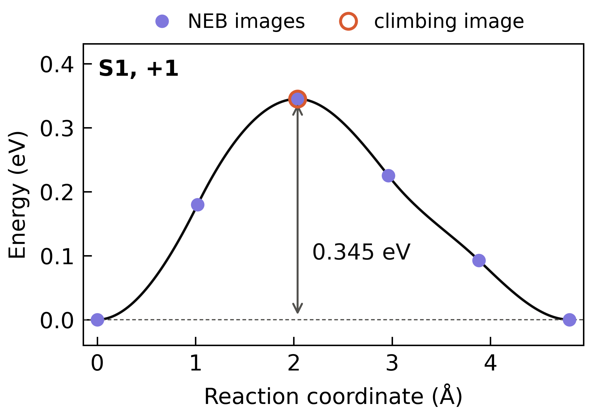
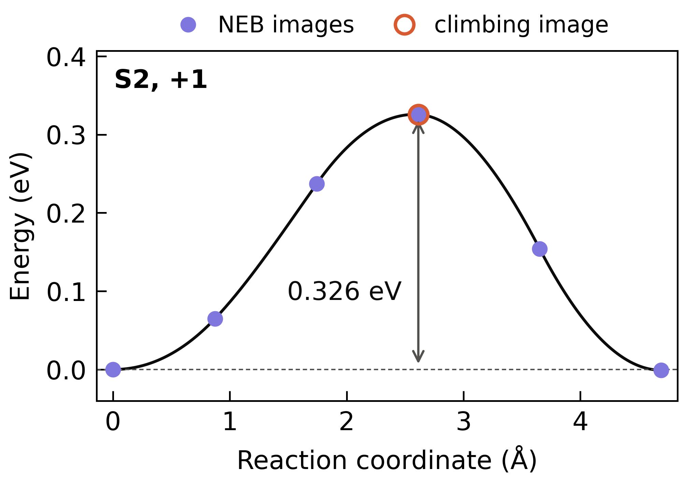
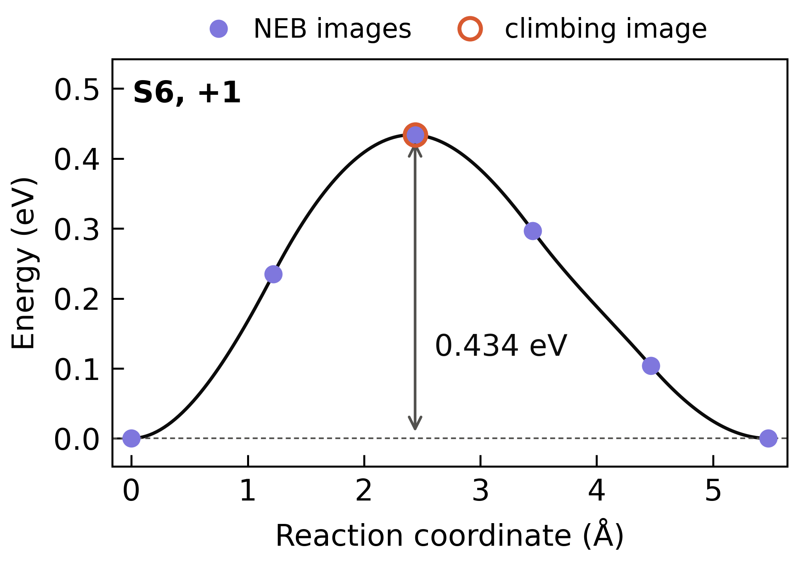
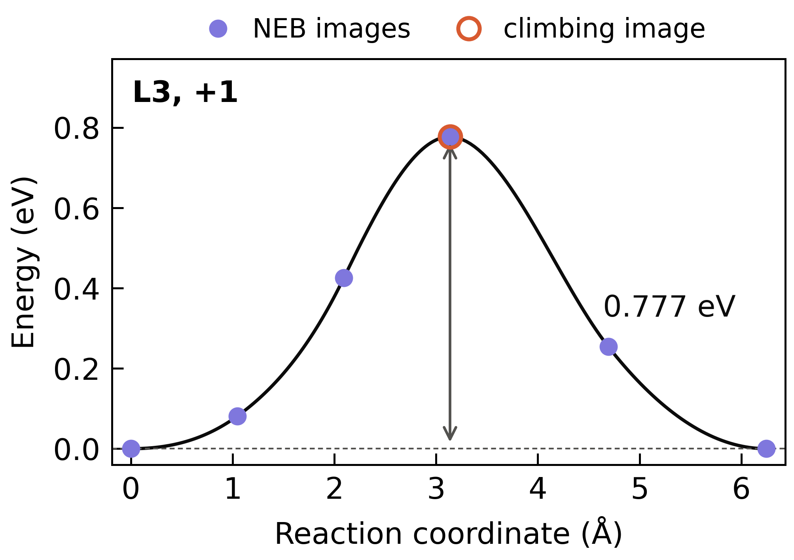

# Iodine Vacancies in γ-CsPbI₃: Thermodynamics, Hop-Resolved Migration and Strain

First-principles study of the iodine vacancy in orthorhombic γ-CsPbI₃ with VASP (PBEsol), with Quantum ESPRESSO as an independent check of the bulk results. The study covers the phase stability and defect thermodynamics, the hop-resolved migration and diffusion tensor, the effect of the charge state on migration, and the effect of biaxial strain on phase stability, vacancy formation and migration.

## Abstract (work so far, November 2026)

Iodine vacancies are the main mobile defect in γ-CsPbI₃, an all-inorganic perovskite whose black phase is metastable against the yellow δ phase. Substrate clamping strain stabilizes the black phase in thin films, but tensile strain also accelerates ion migration in halide perovskites. This study used density functional theory (PBEsol) in 159-atom supercells to resolve the iodine vacancy energetics in γ-CsPbI₃ by site, charge state and migration hop. The two inequivalent iodine sites, apical (4c) and equatorial (8d), were degenerate within 1 meV for the +1 vacancy, with and without spin–orbit coupling. The neutral vacancy behaved as a shallow donor, and the site preference of the neutral vacancy changed sign when spin–orbit coupling was added. Symmetry analysis revealed 10 distinct vacancy hops instead of the three path types reported before. Climbing-image nudged elastic band calculations gave barriers of 0.326 eV (8d–4c), 0.345 eV and 0.434 eV (two 8d–8d hops) and 0.777 eV (4c–4c) for the +1 vacancy, so two hops of the same type differed by a factor of about 30 in rate at 300 K. CsI-terminated (001) slabs showed that the surface reduced the octahedral tilt over a decay length of about 1 nm. An independent Quantum ESPRESSO calculation reproduced the lattice within 0.4%, the site energies within 7 meV and the barrier of the lowest equatorial hop within 0.02 eV. These results show that one barrier per path type does not describe vacancy transport in γ-CsPbI₃ and that the vacancy energetics respond strongly to the octahedral tilt, which strain and surfaces both change.

This repository holds the inputs, scripts and text outputs, but not the scratch data (wavefunctions and charge densities).

## Status

| Part | Item | State |
|---|---|---|
| Setup | Convergence tests, unit cell, 2×2×2 supercell (VASP; QE check) | **Done** |
| A1 | Reference phases CsI, PbI₂, Cs, Pb, I₂ | **Done** |
| A1 | Convex hull: δ-CsPbI₃, Cs₄PbI₆, CsPb₂I₅ (α and β optional) | To do (structures needed) |
| A2 | V_I at +1 and 0, both sites (PBEsol; SOC single points) | **Done** |
| A2 | V_I at 0 with SOC relaxation; V_I at −1 | Running / to do |
| A2 | Charge correction, potential alignment, dielectric constant, HSE06+SOC band edges, formation-energy diagram | HSE06+SOC queued; rest to do |
| B1 | Barriers, +1 vacancy | **S1, S2, S6, L3 done**; S3, S4, S5 queued; L2 check to do |
| B2 | Barriers, neutral vacancy (S1, S2) | To do |
| B3 | Diffusion tensor (master equation on the hop network, Vineyard prefactors) | To do |
| C | Biaxial (001) strain: γ–δ energy, V_I formation, barriers, diffusion tensor | Unit-cell E(c) scans built (36 cells); rest to do |
| Side result | CsI-terminated (001) slabs: tilt recovery against depth | 7–15 layers done; 17 layers running |

## 1. Introduction

### 1.1 γ-CsPbI₃

**Structure and phases.** CsPbI₃ is a halide perovskite with the formula ABX₃. Each Pb atom sits at the centre of an octahedron of six iodine atoms, the octahedra share corners and form a three-dimensional network, and the Cs atoms fill the cavities between them. The compound has four phases.

| Phase | Structure | Notes |
|---|---|---|
| α | Cubic perovskite, octahedra not tilted | Stable only at high temperature |
| β | Tetragonal perovskite, tilted about one axis | Intermediate, on cooling from α |
| γ | Orthorhombic perovskite, tilted about all three axes | The black perovskite phase found at room temperature; metastable |
| δ | Orthorhombic, not a perovskite (yellow) | The stable phase at room temperature; poor light absorber |

**Why the γ phase.** Solar cells and light emitters use the black γ phase, which has a band gap of about 1.7 eV and suits the top cell of a perovskite/silicon tandem. The cubic structure is not an energy minimum at zero temperature because the octahedra lower the energy by tilting, so a relaxation without thermal motion, such as the calculations in this study, ends in the γ structure.


**Reading the figure.** The figure shows the soft-relaxed structure in `qe/01_unitcell/final/`. The top view shows one layer of octahedra, each Pb with the four in-plane iodine atoms, and the Cs atoms above the layer. Neighbouring octahedra rotate about c in opposite senses. The side view shows one sheet of octahedra along the in-plane diagonal, with bent rather than straight Pb–I–Pb links along c.

| Property | Value (this work, VASP PBEsol) |
|---|---|
| Space group | Pnma (No. 62), written here in the Pbnm setting with c as the long axis |
| Atoms per unit cell | 20 (4 Cs, 4 Pb, 12 I) |
| Lattice parameters | a = 8.371 Å, b = 8.950 Å, c = 12.402 Å |
| Pb–I bond lengths | 3.17–3.19 Å |
| Pb–I–Pb angles | 148.5° (equatorial) and 156.2° (apical); 180° in the cubic phase |
| Iodine sites | 4 apical (4c, linking octahedra along c) and 8 equatorial (8d, linking them within the ab plane) |

### 1.2 The two iodine sites


**Apical and equatorial sites.** The tilt makes the six iodine atoms of one octahedron inequivalent. The two **apical (4c)** sites lie above and below Pb along c, in the CsI layers. The four **equatorial (8d)** sites lie around Pb in the PbI₂ layers. The two sites differ only through the octahedral tilt, so any change of the tilt, from strain or from a surface, shifts the energy balance between them.

### 1.3 Ion migration and phase stability

**Ionic weak point.** Halide perovskites tolerate defects electronically because most native defects create no deep trap states. The weak point is ionic. Iodine vacancies form easily and move at room temperature, and the moving ions cause current–voltage hysteresis, ion accumulation at the contacts and loss of stability.

**Phase stability and strain.** The black γ phase of CsPbI₃ transforms into the yellow δ phase at room temperature, fastest in humid air. Steele et al. (2019) kept γ-CsPbI₃ films black by clamping the film to the substrate during quenching, which left about 1% of in-plane tensile strain, and Le et al. (2023) found that more strongly strained nanoplates stayed black longer. Tensile strain, however, also lowers the activation energy of ion migration, as measured in strained films (Zhao et al., 2017, cited by Xu et al., 2019) and calculated for CsPbI₂Br (Xue et al., 2020). The strain that keeps CsPbI₃ black may therefore make the iodine vacancies move faster, and this trade-off has not been quantified.

## 2. Literature review

Full notes, numbers and sources: [`Literatures/literature_review.md`](Literatures/literature_review.md).

### 2.1 Key studies

| Paper | What it did | What it leaves open |
|---|---|---|
| **Arber et al. 2025** (*Chem. Mater.*, anchor) | Bulk γ-CsPbI₃, PBEsol, 2×2×2 supercell. Vacancy barriers 0.34 eV (8d–8d), 0.35 eV (8d–4c), about 0.77 eV (4c–4c); B-site dopants; MD activation energy 0.42 eV | One barrier per path type; charge state not stated; no diffusion tensor |
| **Zhang et al. 2025** (*Appl. Surf. Sci.*) | γ-CsPbI₃, PBEsol, biaxial strain on (100), (010), (001) from −3% to +1%: tilt angles, γ–δ enthalpy difference, formation energies of six defects, V_I barriers for two paths (about 0.51 and 0.54 eV) within ±1%, V_I a shallow donor (SOC levels) | Charge state of the barriers not stated (formulae default to q = 0); D3 added only in the NEB; supercell size not stated; two paths only |
| **Xue et al. 2020** (*Nat. Commun.*) | CsPbI₂Br films: tensile strain from annealing raises ion migration; compressive strain from the hole-transport layer improves stability. DFT for one halide-vacancy path: 0.547, 0.667, 0.794 eV at +1.5%, 0, −1.5% | Not CsPbI₃; one path |
| **Steele et al. 2019** (*Science*) | Substrate clamping leaves about 1% in-plane tensile strain and stabilizes black CsPbI₃ films; SCAN volumes of γ (241 ų per formula unit) and δ (229 ų) | No defect or migration data |
| **Le et al. 2023** (*Matter*) | CsPbI₃ nanoplates on mica: thinner, more strained plates stay black longer; the transformation is linked to surface iodide vacancies (from MD) | No barriers |
| **Smolders et al. 2024** (*Chem. Mater.* 36, 2334) | Orthorhombic (Pnma) CsPbBr₃, SCAN, 320-atom cells: V_Br⁺ and V_Cs⁻ barriers for all nearest-neighbour site pairs (0.23–0.34 eV for V_Br⁺ unstrained) under biaxial strain from −4% to +4% on all three planes; Vineyard prefactors of the moving ion; master-equation diffusivity tensors. The barriers rose or fell with strain depending on the hop and the plane, often non-monotonically | Bromide only; no phase stability; no formation energies against μ and E_F; no charge-state comparison |
| Woo et al. 2022 (*Discovery Mater.* 2, 8) | Cubic CsPbX₃ (X = Cl, Br, I) under triaxial strain: halide-vacancy barriers | Cubic phase only (cited by Smolders et al., not read) |
| **Steele et al. 2021** (*J. Am. Chem. Soc.* 143, 10500) | Perspective: the black-phase stability of γ-CsPbI₃ follows from the suppression of the spontaneous strain that octahedral tilting creates; dopants stabilize γ by reducing the tilt-driven strain | No defect or migration data |
| Ahmad et al. 2024; Biega and Leppert 2021 | Slabs of orthorhombic CsPbI₃ (formation energies against depth) and cubic CsPbBr₃ (surface barriers) | Background for the side result |

### 2.2 Methods taken from the group's earlier work

| Paper | What it did | Used here for |
|---|---|---|
| Xu et al. 2017 (*J. Phys. Chem. Lett.* 8, 4391) | Cs₂AgInBr₆: stability region, formation energies against E_F, transition levels, core-level potential alignment | Part A |
| Xu et al. 2019 (*J. Power Sources* 412, 689) | Cs₂AgInX₆: CI-NEB for the dominant defects in 160-atom cells, diffusion coefficients, biaxial strain (a = b fixed, c from a fit of E(c)); −0.5% raised the Ag_i barrier from 0.15 to 0.24 eV; barriers changed by at most 0.02 eV between PBE+SOC, HSE+SOC and HSE | Parts B and C |

### 2.3 The gap

**Overall gap.** To the authors' knowledge, no study has reported the strain response of every distinct iodine vacancy hop in γ-CsPbI₃ for the charge state that migrates, together with the strain response of the γ–δ stability in the same settings. The overall gap splits into four specific gaps.

| Gap | Statement |
|---|---|
| **G1. Hop resolution** | Bulk barriers are known only per path type, although the tilted structure has 10 symmetry-distinct hops, and the published barriers do not state the charge state. |
| **G2. Charge state** | No study has compared the barriers of the +1 and neutral vacancy in γ-CsPbI₃, although the published values scatter by about 0.2 eV. |
| **G3. Diffusion tensor** | The diffusion of iodine vacancies in γ-CsPbI₃ is known only as an MD average. Smolders et al. (2024) computed hop-resolved diffusivity tensors under strain for CsPbBr₃, but not for the iodide. |
| **G4. Strain trade-off** | Strain stabilizes the black phase (experiment and DFT), and strain changes ion migration (one or two paths, other compositions or an unstated charge state), but both effects have not been computed together for γ-CsPbI₃. |

### 2.4 Research questions and hypotheses

| | Research question | Gap | Hypothesis |
|---|---|---|---|
| **RQ1** | The site preference and formation energy of the vacancy in each charge state, and the charge state that dominates across the band gap | G1 | **H1.** V_I is a shallow donor, so V_I⁺ dominates for every Fermi level in the gap, with degenerate 4c and 8d sites. |
| **RQ2** | The barriers of all short hops and the resulting diffusion tensor | G1, G3 | **H2.** Hops of one type differ by more than 0.03 eV, and transport along c, which needs 4c–8d hops, differs from transport in the ab plane. |
| **RQ3** | The effect of the charge state on the barriers | G2 | **H3.** The neutral and +1 barriers differ by less than 0.03 eV because the extra electron of the neutral vacancy is delocalized. |
| **RQ4** | The effect of biaxial (001) strain on the γ–δ energy difference, the vacancy formation energy, the barriers and the diffusion tensor | G4 | **H4.** Tensile strain of about 1% favours γ over δ, whereas the barriers respond differently from hop to hop (as Smolders et al. (2024) found for CsPbBr₃), so the net effect of the clamping strain on iodine transport has to come from the full tensor. |

### 2.5 Novelty

| | Contribution | Gap |
|---|---|---|
| **N1** | The hop network of the vacancy (barriers, multiplicities, directions) with the charge state stated | G1 |
| **N2** | A direct comparison of +1 and neutral barriers in γ-CsPbI₃ | G2 |
| **N3** | A DFT diffusion tensor of the iodine vacancy in γ-CsPbI₃ | G3 |
| **N4** | A strain map that places phase stability and hop-resolved migration on one scale, at the clamping strain measured by Steele et al. (2019) | G4 |
| **N5** | One consistent set of settings from phase stability to diffusion | G1–G4 |

**Limits on the novelty claim.** The method of Parts B3 and C (hop-resolved barriers, a diffusivity tensor and its strain response) follows Smolders et al. (2024), who applied it to CsPbBr₃, and Zhang et al. (2025) computed the strain response of the γ–δ enthalpy difference and of two vacancy paths in γ-CsPbI₃. The novelty therefore lies in the combination for γ-CsPbI₃, the phase whose black form strain is used to stabilize: the hop-resolved +1 tensor, the γ–δ stability and the formation energy against μ and E_F on one strain scale, and the charge-state comparison.

## 3. Scope

**Three parts.** Part A gives the thermodynamic frame (phase stability and the formation energy of the vacancy). Part B resolves the migration (barriers, charge state and diffusion tensor). Part C applies biaxial strain to the quantities of Parts A and B. Only the iodine vacancy is studied.

| Part | Quantities | Steps |
|---|---|---|
| **A1. Convex hull** | Energies of γ-, δ- (and optionally α-, β-) CsPbI₃, Cs₄PbI₆, CsPb₂I₅, CsI, PbI₂, Cs, Pb and I₂; energy above the hull; chemical-potential region | 1, 5 |
| **A2. Formation energy** | V_I at +1, 0 and −1 on both sites, against E_F and the chemical potentials, with charge correction and potential alignment; transition levels; HSE06+SOC band edges | 2, 3, 8 |
| **B1. Barriers** | +1 barriers of S1–S6 and L3, with L2 as a check of the long hops | 4 |
| **B2. Charge state** | Neutral barriers of S1 and S2 | 4 |
| **B3. Diffusion tensor** | Master equation on the hop network, Vineyard prefactors of the moving ion | 9 |
| **C. Strain** | Biaxial (001) strain of −1%, 0, +0.5% and +1%: γ–δ energy difference, V_I⁺ formation and site energies, barriers of S1, S2 and S6, diffusion tensor | 6 |

**Settings.** All relaxations and NEB calculations use PBEsol without spin–orbit coupling or dispersion, consistent with Arber et al. (2025). Spin–orbit coupling and HSE06 enter as checks. Xu et al. (2019) found that the barriers changed by at most 0.02 eV between functionals, and the +1 results of this study did not change with spin–orbit coupling (Section 5.6).

**Out of scope.** The CsI-terminated slab (step 7) stopped as a full study because the surface reduces the octahedral tilt over about 1 nm, so a slab whose middle reproduces the bulk site energies would need 15 or more layers and slab NEBs on 8 nodes each. The finished slab calculations give the tilt recovery against depth as a side result (Section 5.7).

## 4. Methods

### 4.1 Settings

| Item | VASP (main) | Quantum ESPRESSO (check) |
|---|---|---|
| Version | 6.3.2 with VTST | 7.6 (laptop), 6.5 (cluster) |
| Functional | PBEsol (`GGA = PS`) | PBEsol |
| Potentials | PAW Cs_sv, Pb_d, I | SSSP 1.3.0 efficiency (Cs ultrasoft, Pb and I PAW) |
| Cutoff | 500 eV, `PREC = Accurate`, `LASPH` | 60 Ry (density 480 Ry) |
| k-mesh | 4×4×3 (unit cell), 2×2×2 (supercell), Γ-centred | the same, unshifted |
| Force limit | 0.01 eV/Å | 4×10⁻⁴ Ry/Bohr |
| Spin–orbit coupling | Single points and relaxations as checks (`vasp_ncl`) | Not included |
| Hybrid functional | HSE06+SOC single points at Γ (check) | — |

### 4.2 Steps

| Step | Calculation | Result |
|---|---|---|
| 1 | 20-atom unit cell, variable-cell relaxation | Reference lattice |
| 2 | Perfect 2×2×2 supercell (160 atoms) | Energy and band-edge reference |
| 3 | V_I on 4c and 8d at +1, 0 and −1 | Site energies, formation energies |
| 4 | CI-NEB for S1–S6, L3 (+1), L2 check, S1 and S2 (neutral) | Barriers |
| 5 | Reference and competing phases | Convex hull, chemical-potential region |
| 6 | Biaxial (001) strain on γ, δ and the vacancy supercells | Strain response of the quantities of steps 3, 4, 5 and 9 |
| 7 | CsI-terminated (001) slabs (side result) | Tilt recovery against depth |
| 8 | Charge correction, potential alignment, dielectric constant, HSE06+SOC single points | Formation-energy diagram, transition levels |
| 9 | Master equation on the hop network, Vineyard prefactors | Diffusion tensor |

Each supercell holds one vacancy, and the cell is fixed in all the defect calculations.

### 4.3 Hop set and hop network

**Hop set.** All octahedra are equivalent (Pb on Wyckoff site 4b), and Pb is an inversion centre, so the 12 edges of one octahedron give **six short hops** (S1–S6). Hops between corner-sharing octahedra give **four long hops** (L1–L4).


| Hop | Ends | Length (Å) | | Hop | Ends | Length (Å) |
|---|---|---|---|---|---|---|
| S1 | 8d–8d | 4.40 | | L1 | 8d–8d | 4.78 |
| S2 | 4c–8d | 4.43 | | L2 | 8d–8d | 5.26 |
| S3 | 4c–8d | 4.46 | | L3 | 4c–4c | 5.32 |
| S4 | 4c–8d | 4.52 | | L4 | 4c–8d | 5.98 |
| S5 | 4c–8d | 4.56 | | | | |
| S6 | 8d–8d | 4.60 | | | | |

**Hop network.** The script `tools/hop_network.py` counted the hops of each kind available to one vacancy in the perfect supercell and recorded where each hop leads.

| Hop | Ends | From an 8d vacancy | From a 4c vacancy | Moves the vacancy |
|---|---|---|---|---|
| S1, S6 | 8d–8d | 2 each | 0 | within a PbI₂ layer |
| S2, S3, S4, S5 | 4c–8d | 1 each | 2 each | between a PbI₂ and a CsI layer |
| L1 | 8d–8d | 1 | 0 | within a PbI₂ layer |
| L2 | 8d–8d | 1 | 0 | straight along c, across a CsI layer |
| L3 | 4c–4c | 0 | 2 | within a CsI layer |
| L4 | 4c–8d | 1 | 2 | between layers |
| Total | | 11 | 12 | |

**Consequence for transport.** Transport in the ab plane can run on 8d–8d hops alone, whereas transport along c needs 4c–8d hops (8d → 4c → 8d) or the long L2 hop. The diffusion tensor therefore depends on the barriers of all kinds of hops, the hop counts and the 4c/8d site energies, not on the lowest barrier alone.

**Published paths matched to the hops.** The papers named path types, not variants, so the paths were matched to the hops by geometry. The 4c–4c jump of Arber et al. is L3, the only 4c–4c hop. The 8d–8d and 8d–4c edges of Arber et al. cannot be assigned because their Fig. 1 is a schematic. The "in-plane" and "out-of-plane" paths of Zhang et al. are probably S1 and S2, read from the arrows of their Fig. 6 (±0.3 Å).

### 4.4 Formation energy and phase stability

**Formation energy.** The formation energy of the iodine vacancy in charge state q is

$$
E_\mathrm{f}[V_\mathrm{I}^q] = E[V_\mathrm{I}^q] - E[\mathrm{perfect}] + \mu_\mathrm{I} + q\,(E_\mathrm{VBM} + E_\mathrm{F}) + E_\mathrm{corr}
\tag{1}
$$

where E[V_I^q] is the total energy of the vacancy supercell, E[perfect] is the total energy of the perfect supercell, μ_I is the iodine chemical potential, E_VBM is the valence band maximum of the perfect supercell, E_F is the Fermi level measured from E_VBM, and E_corr is the finite-size correction (Freysoldt scheme with potential alignment).

**Chemical-potential region.** The chemical potentials, written relative to the elemental phases, satisfy

$$
\begin{aligned}
\Delta\mu_\mathrm{Cs} + \Delta\mu_\mathrm{Pb} + 3\,\Delta\mu_\mathrm{I} &= \Delta H_\mathrm{f}(\mathrm{CsPbI_3}),\\
\Delta\mu_\mathrm{Cs} + \Delta\mu_\mathrm{I} &< \Delta H_\mathrm{f}(\mathrm{CsI}),\\
\Delta\mu_\mathrm{Pb} + 2\,\Delta\mu_\mathrm{I} &< \Delta H_\mathrm{f}(\mathrm{PbI_2}),
\end{aligned}
$$

with every Δμ ≤ 0 and the same condition for every other competing phase on the hull.

**Transition level.** The transition level between charge states q and q′ is the Fermi level at which both formation energies are equal,

$$
\varepsilon(q/q') = \frac{E_\mathrm{f}[V_\mathrm{I}^q;\,E_\mathrm{F}=0] - E_\mathrm{f}[V_\mathrm{I}^{q'};\,E_\mathrm{F}=0]}{q' - q}.
\tag{2}
$$

**Site occupation.** For two sites with multiplicities g₄c = 1 and g₈d = 2, the fraction of vacancies on 4c at temperature T is

$$
x_\mathrm{4c} = \left[1 + 2\exp\!\left(-\frac{E(8\mathrm{d}) - E(4\mathrm{c})}{k_\mathrm{B}T}\right)\right]^{-1}.
$$

**Phase stability.** The stability of γ against δ, per formula unit, is

$$
\Delta E_{\gamma\delta} = E_\gamma - E_\delta,
\tag{3}
$$

and the energy above the hull of each phase follows from the lower convex envelope of the formation enthalpies of all phases in the Cs–Pb–I system.

### 4.5 Diffusion tensor

**Hop rates.** Each hop j has the rate

$$
\Gamma_j = \nu\,\exp\!\left(-\frac{E_{\mathrm{a},j}}{k_\mathrm{B}T}\right),
$$

where the attempt frequency ν follows from the Vineyard formula with the vibrational modes of the moving ion only, as in Smolders et al. (2024), in place of the common estimate of 10¹² Hz.

**Master equation.** For one vacancy in the dilute limit, a master equation on the sites of the unit cell, with the rates of all hops, gives the vacancy diffusion tensor exactly (Smolders et al., 2024), which replaces a kinetic Monte Carlo walk

$$
\boxed{D_{\alpha\beta} = \lim_{t\to\infty} \frac{\langle \Delta r_\alpha\,\Delta r_\beta \rangle}{2t}}
\tag{4}
$$

with α, β ∈ {a, b, c}. The iodide diffusion coefficient follows from the vacancy concentration of step 8 and the correlation factor from the same walk.

### 4.6 Strain

**Strain definition.** Following Xu et al. (2019), the biaxial (001) strain fixes the in-plane lattice parameters at

$$
a = a_0\,(1+\varepsilon), \qquad b = b_0\,(1+\varepsilon),
$$

and the out-of-plane parameter c follows from a fit of the total energy E(c), with c scanned from −2% to +2% in 0.5% steps and the atoms relaxed at each point. The same strain is applied to γ and δ, to the perfect supercell and to the vacancy supercells, so every quantity of steps 3, 4, 5 and 9 is computed at ε = −1%, 0, +0.5% and +1%. The tensile values match the clamping strain of about 1% measured by Steele et al. (2019).

## 5. Results so far

### 5.1 Convergence

| k-mesh | VASP, energy above 6×6×4 (meV/atom) | QE (meV/atom) |
|---|---|---|
| 2×2×1 | 45.2 | 45.46 |
| 3×3×2 | 2.48 | 2.52 |
| 4×4×3 | 0.22 | 0.23 |
| 5×5×4 | 0.004 | 0.004 |

**Cutoff.** In VASP, all cutoffs from 350 to 650 eV gave the same energy within 0.08 meV/atom, so 500 eV is well converged. In Quantum ESPRESSO, 60 Ry gave 0.86 meV/atom above 80 Ry.

### 5.2 Relaxed unit cell

| | a (Å) | b (Å) | c (Å) | Volume (ų) |
|---|---|---|---|---|
| Experiment, 293 K | 8.5766 | 8.8561 | 12.4722 | 947.33 |
| **VASP** | **8.3705** | **8.9497** | **12.4020** | **929.08** |
| QE (tight relaxation) | 8.3620 | 8.9607 | 12.3503 | 925.41 |
| VASP vs experiment | −2.40% | +1.06% | −0.56% | −1.93% |

**Lattice.** The VASP cell agreed with the QE cell within 0.4% on every axis. Like every other 0 K relaxation, the cell is rectangular in the ab plane (a and b 6.9% apart), whereas the cell of Arber et al. (2025) was nearly square (0.3% apart, Section 5.8).

### 5.3 Perfect supercell and band gap

| | Value |
|---|---|
| Total energy (VASP) | −486.51068 eV (160 atoms) |
| Band gap, PBEsol (direct at Γ) | 1.619 eV |
| Band gap, PBEsol + SOC | 0.703 eV |
| Memory | 14 GB per std40 node on 4 nodes |

**Band gap.** The PBEsol gap is close to the measured 1.73 eV only because the missing spin–orbit coupling and the semilocal underestimate of the gap cancel. Spin–orbit coupling lowered the Pb-6p conduction band and closed the gap by 0.92 eV, so the band edges for the formation-energy diagram come from HSE06+SOC (queued).

### 5.4 Stability region

| Compound | ΔH_f, VASP (eV per formula unit) | QE | Experiment (approx.) |
|---|---|---|---|
| CsI | −3.079 | −3.092 | −3.59 |
| PbI₂ | −1.827 | −1.837 | −1.82 |
| γ-CsPbI₃ | −4.985 | −4.991 | — |

**Decomposition margin.** γ-CsPbI₃ was stable against CsI + PbI₂ by only **79 meV per formula unit** (QE 63 meV), so the region is a thin strip in the (Δμ_Pb, Δμ_I) plane, running from the iodine-rich end (Δμ_I = 0) to the iodine-poor end (Δμ_I ≈ −0.93 eV). The vacancy formation energy contains +μ_I, so the strip reduces in practice to one variable, Δμ_I. CsI is about 0.5 eV less bound than measured, a known GGA tendency for alkali compounds. Solid I₂ lay 0.31 eV per atom below the I₂ molecule (measured sublimation energy about 0.32 eV). δ-CsPbI₃, Cs₄PbI₆ and CsPb₂I₅ are not yet included and can only shrink the strip.


### 5.5 Iodine vacancy: site energies

| Charge | E(8d) − E(4c), QE | VASP | VASP + SOC (single point) | VASP + SOC (relaxation, running) |
|---|---|---|---|---|
| +1 | −1.1 meV | +0.9 meV | +1.0 meV | — |
| 0 | +40.4 meV | +33.5 meV | −71.0 meV | −17.5 meV after 9 and 4 steps |

**+1 vacancy.** The two sites were degenerate within 1 meV in both codes and with spin–orbit coupling, and the largest SOC force on the PBEsol structures was 0.015 eV/Å, at the relaxation limit. With degenerate sites, one third of the +1 vacancies sit on 4c at any temperature.

**Neutral vacancy.** Both neutral cells ended with a total magnetisation of 0 μB, so the extra electron delocalized and the vacancy acted as a shallow donor. The site preference depended on the method. Spin–orbit coupling reversed the sign and produced forces of 0.09–0.27 eV/Å, and the SOC relaxation reduced the difference from −71 to −17.5 meV within the first steps. The extra electron occupies the Pb-6p conduction band, which spin–orbit coupling shifts, so the neutral site energy is not a robust quantity at this level of theory.

### 5.6 Barriers, +1 vacancy

| Hop | Ends | Barrier (eV) | Image energies (eV) | Steps |
|---|---|---|---|---|
| S2 | 8d → 4c | **0.326** (0.327 from 4c) | 0.065, 0.237, **0.326**, 0.154 | 27 |
| S1 | 8d → 8d | **0.345** | 0.180, **0.345**, 0.225, 0.093 | 25 |
| S6 | 8d → 8d | **0.434** | 0.235, **0.434**, 0.297, 0.104 | 39 |
| L3 | 4c → 4c | **0.777** | 0.081, 0.426, **0.777**, 0.254 | 33 |

All four NEBs (VASP/VTST, four moving images, climbing image) converged below 0.03 eV/Å on every image. Energies are relative to the starting vacancy, and the reaction coordinate is the summed atomic displacement between images.









**Agreement with Arber et al.** The S1 barrier (0.345 eV) agrees with the 0.34 eV that Arber et al. (2025) reported for an 8d–8d edge, the S2 barrier (0.326 eV) is close to their 0.35 eV for the 8d–4c type, and the L3 barrier (0.777 eV) agrees with their 0.77 eV. Zhang et al. (2025) reported about 0.54 eV for the path matched to S1, about 0.2 eV above both Arber et al. and this study.

**Spread within one type.** The two 8d–8d edges differ by 0.09 eV (S1 0.345 eV, S6 0.434 eV), so at 300 K the S6 rate is about 30 times lower than the S1 rate, and one barrier per path type does not describe the network. The lowest barrier belongs to S2, which joins a PbI₂ layer to a CsI layer, so transport along c is not blocked by a higher barrier. L3 is about 10⁷ times slower than S1 and drops out of the bulk diffusion.

**Cross-check.** An independent Quantum ESPRESSO calculation gave 0.361 eV for S1, within 0.02 eV of the VASP value.

### 5.7 Side result: CsI-terminated (001) slabs

**Energy.** The energy cost of two additional layers approached two formula units of bulk within 4 meV from 11 layers on (offsets 6.9, 4.2, 3.5 and 4.0 meV for 7→9, 9→11, 11→13 and 13→15 layers), which is the k-mesh error of the bulk reference.

| Depth below the CsI surface | Apical Pb–I–Pb, 11 layers | 13 layers | Bulk |
|---|---|---|---|
| 5.9 Å (layer 3) | 157.83° | 157.72° | 156.17° |
| 12 Å (layer 5) | 157.10° (middle) | 156.87° | 156.17° |
| 18 Å (layer 7) | — | 156.74° (middle) | 156.17° |

**Tilt recovery.** Bonds and equatorial angles reached the bulk values by the second PbI₂ layer (about 9 Å), whereas the apical tilt recovered over a decay length of about 1 nm per surface, and the middle PbI₂ spacing stayed 0.3–0.45% above the bulk value. This agrees with the cubic-like surface shell of about 2 nm that Pols et al. (2022) observed in reactive MD.

**Sensitivity of the site energy.** At the centre of an 11-layer 2×2 slab, E(8d) − E(4c) of the +1 vacancy was at most −21 meV, against +1 meV in the bulk, with the 4c vacancy in the CsI layer 3.1 Å from the centre. The 4c/8d balance therefore shifts by about 20 meV for a 0.9° change of the apical angle, which makes the site energy a sensitive probe of the tilt under strain.

### 5.8 Comparison with the published benchmark

**Cell shape.** The relaxed cell of Arber et al. (2025) was nearly square in the ab plane (8.68 and 8.71 Å, 0.3% apart), unlike the experimental cell (8.58 and 8.86 Å, 3.3% apart) and every other 0 K relaxation found (6.8–7.6% for PBEsol and HSE06, 4–13% for LDA, PBE and SCAN). The 4c and 8d sites differ only through the octahedral tilt, and Section 5.7 shows how strongly the site energy responds to the tilt, so a less-tilted cell may explain part of the difference in the published site energies. The file `Literatures/literature_review.md` gives the details.

## 6. File structure

**Layout.** The VASP work sits in `vasp/`, the Quantum ESPRESSO check in `qe/`, and the scripts used with both codes in `tools/`. Inside `qe/` and `vasp/`, each step of the Methods has one numbered folder.

```
.
├── README.md                    this file
├── NOTES.md                     working notes: cluster, jobs, decisions, commands
├── Literatures/                 literature_review.md and the papers (not tracked)
├── LICENSE
├── assets/                      figures used in this README
├── presentation/                progress report for the supervisor (Beamer source and PDF)
│
├── vasp/                        VASP, the main calculations (see vasp/README.md)
│   ├── build_vasp.py            inputs for steps 1, 2, 3, 5, 6 and 7 (unitcell, supercell, refs, strain, slab, slabvac)
│   ├── make_potcar.sh           POTCAR from POSCAR, on the cluster
│   ├── make_soc.sh              SOC single points and relaxations (soc/, soc_relax/)
│   ├── make_hse.sh              HSE06+SOC single points at Γ (hse_soc/)
│   ├── run_vasp.pbs             PBS job script with memory watch and swap guard
│   ├── 01_unitcell/             step 1: cutoff and k-mesh tests, relaxation
│   ├── 02_pristine/             step 2: perfect 2×2×2 supercell
│   ├── 03_vacancies/            step 3: q+1/ and q0/, vac_I_apical and vac_I_equatorial
│   ├── 04_bulk_neb/q+1/         step 4: S1–S6, L3 (00 … 05, neb_data.txt)
│   ├── 05_reference_phases/     step 5: Cs, Pb, I₂, CsI, PbI₂, I₂ molecule
│   ├── 06_strain/               step 6: biaxial strain, unit/eps*/c* E(c) scans
│   └── 07_slab/                 step 7: CsI-terminated slabs L07 … L17 (side result)
│
├── qe/                          Quantum ESPRESSO check, steps 1–5
│   ├── 01_unitcell/ … 05_reference_phases/   (04_bulk_neb holds the converged S1 only)
│   ├── run_qe.pbs, run_neb.pbs  PBS job scripts
│
└── tools/                       scripts for both codes
    ├── build_neb.py             NEB inputs from the relaxed vacancies (--code qe or vasp)
    ├── fit_strain_c.py          E(c) fit per in-plane strain → c(ε), ΔE
    ├── hop_network.py           hop counts and directions → hop_network.txt
    ├── plot_neb.py              NEB energy profile in the project figure style (QE or VASP)
    └── slab_geometry.py         layer-by-layer bonds, angles and spacings of a slab
```

**Cluster copy.** The cluster copy lives in `~/cspbi3/`. The QE step folders and job scripts sit directly in `~/cspbi3/`, not in a `qe/` folder, and `vasp/` is the same in both places.

## 7. How to reproduce

**Software.** Python 3.14.4, numpy 2.3.5, scipy 1.16.3, ASE 3.26.0 and spglib 2.7.0 (WSL, system Python). The cluster has no Python, so the scripts run locally and the outputs are copied to the cluster.

```bash
# VASP inputs (from the project root)
python3 vasp/build_vasp.py unitcell
python3 vasp/build_vasp.py supercell --unit vasp/01_unitcell/relax/CONTCAR
python3 vasp/build_vasp.py refs
python3 tools/build_neb.py S1 --charge q+1 --code vasp
python3 tools/plot_neb.py --vasp vasp/04_bulk_neb/q+1/S1 --label "S1, +1" --out assets/neb_S1_qp1_vasp.png

# on the cluster, from ~/cspbi3/vasp
bash make_potcar.sh 03_vacancies/q+1/vac_I_apical
bash make_soc.sh 03_vacancies/q+1/vac_I_apical            # RELAX=1 for a SOC relaxation
bash make_hse.sh 02_pristine                               # HSE06+SOC at Γ

# Quantum ESPRESSO check
python3 qe/03_vacancies/build_defects.py qe/01_unitcell/tight/unit_tight_relaxed.in --out qe --pseudo-dir /path/to/pseudo
```

## 8. Not tracked

- `tmp/`, `*.save/`, `*.wfc*`, `*.xml`: Quantum ESPRESSO scratch data
- `POTCAR`, `WAVECAR`, `CHG`, `CHGCAR`: VASP potentials (licensed) and scratch data
- `Literatures/*.pdf`, `Literatures/*.docx`: the papers and supporting information (copyrighted)
- `backup/`, `*:Zone.Identifier`, `__pycache__/`

## 9. Next steps

1. Part A1: relax δ-CsPbI₃, Cs₄PbI₆ and CsPb₂I₅ (structures needed) and build the convex hull.
2. Part A2: finish the neutral SOC relaxations, relax V_I⁻ on both sites, compute the dielectric constant and the potential alignment, and combine them with the HSE06+SOC band edges into the formation-energy diagram.
3. Part B: finish S3, S4 and S5, run the L2 check and the neutral S1 and S2 NEBs, and compute the diffusion tensor.
4. Part C: strain γ, δ and the vacancy supercells at −1%, 0, +0.5% and +1%, then repeat the barriers of S1, S2 and S6 and the diffusion tensor.
