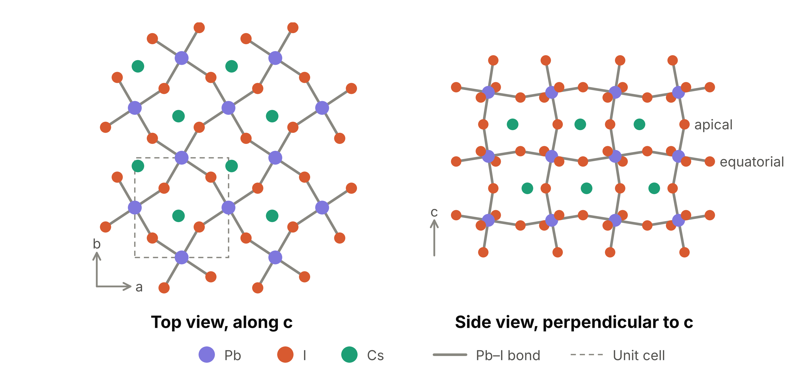
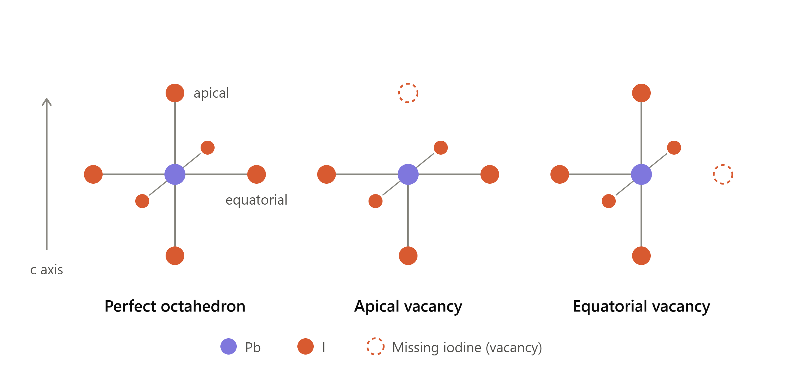
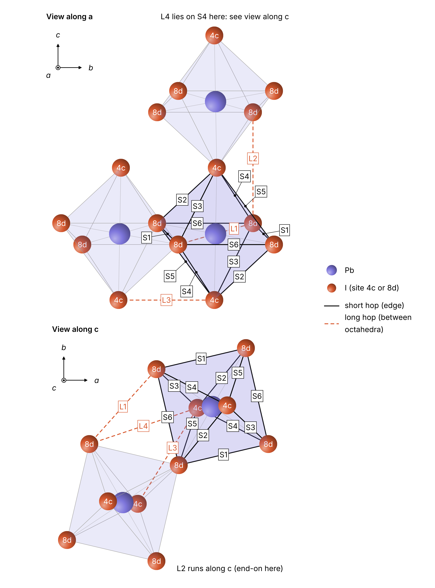
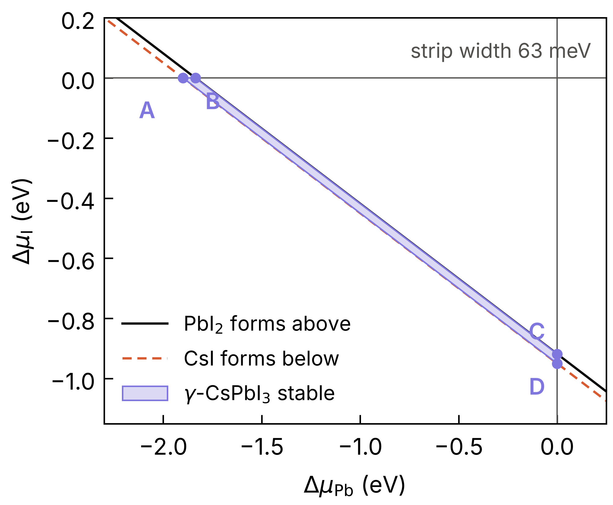
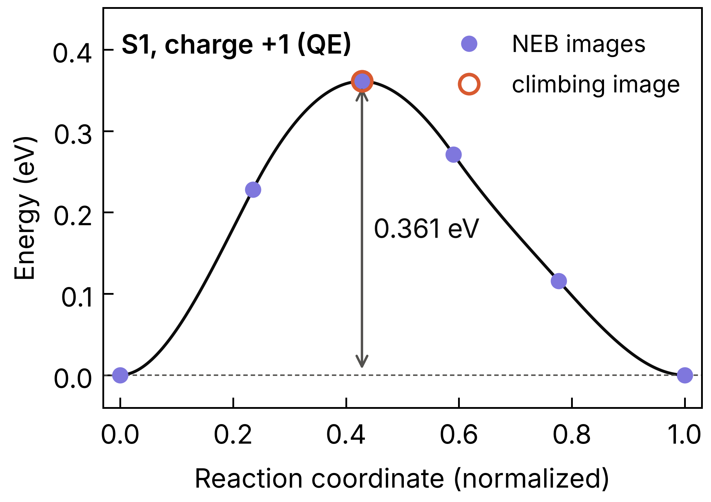

# Formation and Migration of Iodine Vacancies in γ-CsPbI₃

First-principles study of iodine vacancies in orthorhombic γ-CsPbI₃ using Quantum ESPRESSO and VASP. The study covers the bulk defect thermodynamics, the hop-resolved diffusion and the CsI-terminated (001) surface.

## Abstract (work so far, November 2026)

Iodine vacancies are the main mobile defect in γ-CsPbI₃, a promising inorganic perovskite for solar cells. The migration of these vacancies causes current–voltage hysteresis and degradation. The tilted octahedra in the γ phase create two inequivalent iodine sites, apical (4c) and equatorial (8d). However, published studies have reported only three migration path types and have not stated the vacancy charge state. This study used density functional theory (PBEsol) in 159-atom supercells to compare both sites for the neutral and +1 vacancies and to identify the symmetry-distinct hops. The +1 vacancy showed almost no site preference, with the 8d site only 1 meV lower. The neutral vacancy favoured the apical site by 40 meV, opposite to the published result, and behaved as a shallow donor, with the extra electron delocalized over the crystal. Symmetry analysis revealed 10 distinct hops, six short and four long, rather than three. The first nudged elastic band calculation gave a barrier of 0.361 eV for an equatorial hop of the +1 vacancy, close to the published 0.34 eV. A second code, VASP, reproduced the relaxed lattice within 0.4% and the formation enthalpies within 13 meV per formula unit. These results show that the iodine vacancy energetics in γ-CsPbI₃ depend on both the charge state and the octahedral tilt.

The abstract covers the bulk work done so far. The scope was extended on 23 October 2026 (see Scope).

This repository holds the inputs, scripts and text outputs, but not the scratch data (wavefunctions and charge densities).

## Status

| Stage | State |
|---|---|
| Convergence test, soft and tight relaxation of the unit cell | Done |
| Cluster setup; `neb.x` and `pp.x` compiled (Quantum ESPRESSO 6.5) | Done |
| Perfect 2×2×2 supercell relaxation | Done |
| Vacancy relaxations (4 jobs) | All four done in QE |
| Set of distinct bulk hops | Settled: 10 (6 short, 4 long) |
| Hop end points and NEB inputs (`build_neb.py`, `hop_network.py`, `run_neb.pbs`) | Done |
| Bulk barriers (NEB) | Stage 1 (S1, S2, L3, S6): **S1 done in QE, 0.361 eV (+1)**. The other three hops will run in VASP |
| VASP counterpart (`vasp/`) | Unit cell, convergence tests, reference phases and perfect supercell done (agreement with QE within 0.4% and 13 meV). Vacancy cells running |
| Part A: reference phases and chemical-potential region (step 5) | **Done** for elements and binaries; Cs₄PbI₆, CsPb₂I₅ to add |
| Part A: formation energies, transition levels, defect concentrations (step 6) | To do |
| Part B: diffusion coefficients and anisotropy (step 7) | To do |
| Part C: CsI-terminated slab, vacancies and barriers against depth (steps 8–10) | Step 8 thickness test submitted (VASP, 7, 9 and 11 layers). Steps 9 and 10 to do |

## Introduction

### γ-CsPbI₃

CsPbI₃ is a halide perovskite with the formula ABX₃. Each Pb atom sits at the centre of an octahedron of six iodine atoms. The octahedra share corners and form a three-dimensional network, and the Cs atoms fill the cavities between them.

The compound has four phases.

| Phase | Structure | Notes |
|---|---|---|
| α | Cubic perovskite, octahedra not tilted | Stable only at high temperature |
| β | Tetragonal perovskite, tilted about one axis | Intermediate, on cooling from α |
| γ | Orthorhombic perovskite, tilted about all three axes | The black perovskite phase found at room temperature; metastable |
| δ | Orthorhombic, not a perovskite (yellow) | The stable phase at room temperature; poor light absorber |

Solar cells and light emitters use the γ phase, which has a band gap of 1.7 eV.

The cubic structure is not an energy minimum at zero temperature because the octahedra lower the energy by tilting. A relaxation without thermal motion, such as the calculations in this study, therefore ends in the γ structure. The γ structure is also the perovskite phase present in devices at room temperature.



The figure shows the soft-relaxed structure in `01_unitcell/final/`. The tight relaxation moved the atoms by less than 0.03 Å, which is not visible at this scale. The top view shows one layer of octahedra (each Pb with the four in-plane iodine atoms) and the Cs atoms above the layer. Neighbouring octahedra rotate about c in opposite senses. The side view shows one sheet of octahedra along the in-plane diagonal, with bent rather than straight Pb–I–Pb links along c.

| Property | Value (this work, PBEsol) |
|---|---|
| Space group | Pnma (No. 62), written here in the Pbnm setting with c as the long axis |
| Atoms per unit cell | 20 (4 Cs, 4 Pb, 12 I) |
| Lattice parameters | a = 8.362 Å, b = 8.961 Å, c = 12.350 Å |
| Pb–I bond lengths | 3.17 to 3.19 Å |
| Pb–I–Pb angles | 148° (equatorial) and 155° (apical); 180° in the cubic phase |
| Iodine sites | 4 apical (linking octahedra along c) and 8 equatorial (linking them within the ab plane) |

The tilting makes the two iodine sites different, so this study treats the apical and equatorial positions separately.

### The two iodine sites



Each Pb sits at the centre of an octahedron of six iodine atoms. The tilt makes these six atoms inequivalent, with two apical and four equatorial sites.

- **Apical (4c)**: the two above and below Pb, along c, in the CsI layers.
- **Equatorial (8d)**: the four around Pb, in the PbI₂ layers.

### Why defects matter

Halide perovskites tolerate defects electronically because most native defects create no deep trap states. Solution-processed films therefore still perform well. The weak point of these materials is ionic. Iodine vacancies form easily and move at room temperature, and the moving ions cause three problems.

- Current–voltage hysteresis and a slow, drifting response in solar cells and detectors.
- Ions piling up at interfaces and reacting with contacts.
- Loss of stability, including the change of γ-CsPbI₃ to the yellow δ phase, which tends to start at surfaces and grain boundaries.

Vacancies form, collect and escape at surfaces, where the perovskite also meets the other device layers. The vacancy mobility near the surface, and whether the surface attracts vacancies, guides the surface passivation and interface design.

## Literature review

Full notes, numbers and sources: [`Literatures/literature_review.md`](Literatures/literature_review.md).

| Paper | What it did | What it leaves open |
|---|---|---|
| **Arber 2025** (anchor) | Bulk γ-CsPbI₃, PBEsol, 2×2×2 supercell: iodine vacancy barriers 0.34 eV (8d-8d), 0.35 eV (8d-4c), about 0.77 eV (4c-4c); MD activation energy 0.42 eV | Surfaces; more than one barrier per type of path; the charge state |
| Biega 2021 | Cubic CsPbBr₃ slabs: the long axial-to-axial barrier is about half the bulk value at the surface | Edge hops; the tilted phase; a slab whose barriers return to the bulk value |
| Ahmad 2024 | Orthorhombic CsPbI₃ 17-layer slabs: vacancy and interstitial formation energies against depth | Barriers; a slab interior that matches the bulk (off by 0.05–0.66 eV) |
| Zhang 2025 | Bulk γ-CsPbI₃ under strain, PBEsol: two V_I paths, about 0.51 eV (edge towards the apical site) and 0.54 eV (in-plane); rectangular relaxed cell with PBEsol, PBE and HSE06; V_I a shallow donor | Charge state and supercell size; site energies; only two paths |

**Methods taken from the group's earlier work** (J.-B. Liu group, same approach for other halide perovskites)

| Paper | What it did | Used here for |
|---|---|---|
| Xu 2017 (J. Phys. Chem. Lett. 8, 4391) | Cs₂AgInBr₆: chemical-potential stability region, formation energies of all intrinsic defects against E_F, transition levels, self-consistent Fermi level and defect and carrier concentrations | Part A, steps 5–6 |
| Xu 2019 (J. Power Sources 412, 689) | Cs₂AgInX₆: CI-NEB for the dominant defects only (vacancy and concerted interstitial mechanisms), diffusion coefficients, strain effect. SI: barriers change by ≤ 0.02 eV between PBE+SOC, HSE+SOC and HSE; halogen-vacancy levels stay at the band edge in all three | Part B, step 7; barriers kept at the GGA level |
| Zhou 2021 (J. Mater. Chem. A 9, 6955) | CsGe₁₋ₓSnₓI₃: deep or shallow defect levels from aligned Kohn–Sham levels (Cs 1s core level), partial charge densities, COHP | Defect-state analysis of the neutral vacancy |

The group relaxed the structures with PBE and spin–orbit coupling (PBE+SOC), ran single points with HSE06+SOC, aligned the potentials with core levels and used no image-charge term. The compounds in those studies contain no lead, so the small SOC effects found there do not transfer automatically to CsPbI₃, where SOC moves the Pb-6p conduction band by about 1 eV. This study will check SOC on the CsPbI₃ defect cells.

### The gap

- **Arber et al. (2025)** gave one barrier per type of path, although the tilted structure has several distinct variants of each type, and did not state the charge state.
- **Biega and Leppert (2021)** showed a surface effect for one long jump only, in the cubic bromide, in a thin, partly frozen slab that never returned to the bulk value.
- **Ahmad et al. (2024)** studied the right material and surface but reported only formation energies, and the slab interior did not reproduce the bulk value.
- **Zhang et al. (2025)** reported barriers for the top layer of a γ-CsPbI₃ (001) film only, not against depth.

**Overall gap.** To the authors' knowledge, no study has reported iodine vacancy migration barriers in γ-CsPbI₃ layer by layer below the surface, in a slab whose interior reproduces the bulk.

The overall gap splits into four specific gaps.

| Gap | Statement |
|---|---|
| **G0 — Defect picture** | No consistent picture of which intrinsic defects dominate γ-CsPbI₃, in which charge state, computed with the same settings as the barriers. Ahmad et al. (2024) covered equatorial sites only, with PBE+D3 on the experimental cell. Most other defect studies used the cubic phase. |
| **G1 — Hop resolution** | Bulk barriers are known only per type of path, although the tilted structure has 10 symmetry-distinct hops (six short and four long). The published values do not state the charge state. |
| **G2 — Depth** | The surface effect on vacancy migration is known only for one long jump in cubic CsPbBr₃ and for the top layer of a γ-CsPbI₃ (001) film. No study has reported barriers against depth in γ-CsPbI₃, so the depth reached by the surface effect is unknown. |
| **G3 — Slab–bulk consistency** | Neither surface study recovered the bulk value inside the slab, so the surface and bulk values cannot be compared cleanly. |

### Research questions

| | Question | Gap | Hypothesis |
|---|---|---|---|
| **RQ0** | Which intrinsic defects dominate γ-CsPbI₃, in which charge state, under which growth conditions? | G0 | **H0.** V_I is a shallow donor, in the +1 state for any Fermi level in the gap, and one of the dominant defects; V_Pb or V_Cs is the main acceptor. |
| **RQ1** | Which site does the vacancy prefer, and by how much, in each charge state? | G1 | **H1.** 8d by a few hundredths of an eV in both; one charge state reproduces the +0.03 eV of Arber et al. (2025). |
| **RQ2** | What are the bulk hop barriers, and how do the number and direction of hops shape transport in the ab plane and along c? What diffusion coefficients and ionic conductivity follow? | G1 | **H2.** Variants of one type differ by a few hundredths of an eV; long hops are clearly higher. Transport along c needs 4c–8d hops, so the barriers of these hops and the time the vacancy spends on 4c set the transport along c, which makes the diffusion anisotropic. |
| **RQ3** | How do site energies and barriers change layer by layer below the CsI-terminated surface? | G2 | **H3.** Barriers drop and the vacancy is slightly more stable in the top layers; the effect fades within two to three layers (about 1 nm). |
| **RQ4** | Once the surface splits each pair of equivalent hops, which direction is favoured? | G2 | **H4.** Hops towards the surface are easier, giving a net drift of vacancies to the surface. |
| **RQ5** | Does the middle of the slab reproduce the bulk site energy and barrier? | G3 | **H5.** Yes, within about 0.02 eV, for a symmetric 11-layer slab with all atoms free. |

**Novelty**

| | Contribution | Gap |
|---|---|---|
| **N1** | The hop network of the vacancy (barriers, multiplicities, directions) with both charge states stated, and a bulk reference for every hop the slab will split | G1 |
| **N2** | Depth-resolved vacancy barriers in γ-CsPbI₃, followed back to the bulk | G2 |
| **N3** | The surface splitting of equivalent hops as a measure of directional drift | G2 |
| **N4** | A slab checked against a bulk reference with the same settings | G3 |
| **N5** | One consistent set of settings from defect thermodynamics to diffusion: charge state, site preference, hop network and diffusion coefficients together | G0, G1 |

**Limits on the novelty claim.** A web search and a cited-by check of the papers by Arber et al., Biega and Leppert, and Ahmad et al. (October 2026, Google Scholar and the publishers' "cited by" lists) found no depth-resolved vacancy barriers in γ-CsPbI₃. The closest studies were Pols et al. (2022), with reactive MD of CsPbI₃ slabs that showed iodine vacancies moving in and out of the surface but gave no barriers, surface studies of CsPbI₃ with formation energies only (Li et al., arXiv 2411.01599; arXiv 2309.04870), bulk-only migration studies (Tyagi et al., arXiv 2409.16051; Miskin et al., 2025) and the top-layer barriers of Zhang et al. (2025). The Ahmad group works on defect mobility near interfaces in other materials and is the most likely group to extend the formation-energy study to barriers.

**If the hypotheses fail.** If H3 is false (no change below the top layer), the surface effect is confined to one layer, which still answers G2. If H5 is false, a comparison of the neutral and +1 vacancies separates a structural mismatch from a charge-referencing error, which answers G3.

### Scope

The scope was extended on 23 October 2026 after feedback from the supervisor. The bulk work now covers which defects form and in which charge state (Part A) and how fast the vacancy diffuses (Part B), in the style of the group's earlier work. The surface (Part C) remains the main new contribution.

On 31 October the supervisor asked for every step to be repeated in VASP, so the two codes cross-check the bulk results. The slab steps (8–10) run in VASP only because a slab NEB in Quantum ESPRESSO would need about 85 GB per node, more than the 75 GB planned for a std40 node (see NOTES.md).

| Part | Content | Steps | Needed for |
|---|---|---|---|
| **A. Bulk defect thermodynamics** | Chemical-potential region of γ-CsPbI₃ against CsI, PbI₂ (and Cs₄PbI₆, CsPb₂I₅), Cs, Pb, I₂; formation energies against E_F for V_I (+1, 0) and the main competing defects V_Pb²⁻, V_Cs⁻, I_i (−, 0, +); transition levels with core-level alignment; self-consistent Fermi level and defect concentrations at 300 K | 5, 6 | G0 |
| **B. Bulk migration** | 4c and 8d site energies (done); NEB in stages, starting with the hops that have published values; iodine interstitial NEB if Part A shows it dominant; diffusion coefficients, anisotropy and ionic conductivity | 3, 4, 7 | G1 |
| **C. Surface** | CsI-terminated (001) slab whose middle reproduces the bulk; V_I formation energy and barriers layer by layer, using the chemical potentials of Part A | 8–10 | G2, G3 |

**Settings.** All the relaxations and NEB calculations use PBEsol without spin–orbit coupling or dispersion, consistent with the earlier steps and with Arber et al. (2025). Spin–orbit coupling and, if time allows, HSE06 will enter as single points on the relaxed defect cells, where they affect the transition levels. Xu et al. (2019) found that the barriers changed by at most 0.02 eV between functionals.

**Not in the current scope**

- The full set of about 20 intrinsic defects (to be confirmed with the supervisor, because the four defects above set the Fermi level)
- δ-CsPbI₃ in the stability region (γ is metastable against δ, so the region is drawn without δ, as is usual)
- PbI₂ termination and other facets
- Machine-learned potentials and long-time dynamics

**Optional, later.** In-plane strain on the slab barriers (the strain method of Xu et al. (2019), applied to the depth profile rather than to the bulk as in Zhang et al. (2025)); Bi doping as a donor that may lower the V_I⁺ concentration (Zhang, Xie and Chen, 2022); cubic α-CsPbI₃ as a no-tilt reference barrier; the partial charge density of the neutral vacancy state.

## Methods

### Settings

| Item | Value |
|---|---|
| Code | Quantum ESPRESSO `pw.x`: version 7.6 on the laptop (convergence test, soft relaxation), version 6.5 on the cluster (tight relaxation and all defect calculations) |
| Functional | PBEsol |
| Spin-orbit coupling | Not included in relaxations and NEB (scalar-relativistic pseudopotentials); single-point check on the defect cells in step 6 |
| Dispersion correction | None |
| Pseudopotentials | SSSP 1.3.0 PBEsol efficiency |
| Plane-wave cutoff | 60 Ry (density 480 Ry) |
| k-mesh, 20-atom cell | 4×4×3 |
| k-mesh, 160-atom supercell | 2×2×2 |

**Pseudopotential files**

| Element | File |
|---|---|
| Cs | `cs_pbesol_v1.uspp.F.UPF` |
| Pb | `Pb.pbesol-dn-kjpaw_psl.0.2.2.UPF` |
| I | `I.pbesol-n-kjpaw_psl.0.2.UPF` |

The VASP counterpart (PAW potentials Cs_sv, Pb_d and I, 500 eV, Γ-centred k-meshes) is described in `vasp/README.md`.


| Step | Calculation | Result |
|---|---|---|
| 1 | Tight relaxation of the 20-atom cell | Reference lattice. **Done** |
| 2 | Perfect 2×2×2 supercell (160 atoms) | Energy reference |
| 3 | 4c and 8d vacancy, charge +1 and neutral | Site energy difference; charge state compared with Arber et al. |
| 4 | NEB for the 10 distinct bulk hops | Bulk barriers; validation against Arber et al. |
| 5 | Reference phases: Cs, Pb, I₂, CsI, PbI₂ (Cs₄PbI₆, CsPb₂I₅) | Chemical-potential region of γ-CsPbI₃ |
| 6 | Defect cells V_Pb, V_Cs, I_i (with V_I from step 3); core-level alignment; SOC single points | Formation energies against E_F, transition levels, self-consistent Fermi level and concentrations |
| 7 | Barriers + hop network + site energies (+ step 6 concentrations) | Diffusion coefficients, anisotropy, ionic conductivity |
| 8 | CsI-terminated (001) slab: build and convergence (VASP) | Slab whose middle reproduces the bulk |
| 9 | Vacancies at increasing depth (VASP) | Site and formation energy against depth |
| 10 | NEB at increasing depth (VASP) | Barriers against depth, converging to step 4 |

Each supercell holds one vacancy, and the cell is fixed in all the defect calculations.

### Bulk (steps 2 to 4)

**Validation targets from Arber et al. (2025)** (same material, functional and supercell)

| Quantity | Arber et al. | Check in this study |
|---|---|---|
| Vacancy site energy, 4c minus 8d | about +0.03 eV (inferred from the end points of Fig. S1 of Arber et al., not stated in the text) | Step 3, both charge states |
| Barrier 8d to 8d | 0.34 eV | Step 4 |
| Barrier 8d to 4c (average of both directions) | 0.35 eV | Step 4 |
| Barrier 4c to 4c (long jump) | about 0.77 eV | Step 4 |

Arber et al. did not state the charge state. The charge state in this study that reproduces these numbers indicates the one they used. A second reference, Zhang et al. (2025), used PBEsol with a rectangular cell like the one in this study. Fig. 6c of Zhang et al. gave about 0.51 eV for an edge hop towards the apical site and 0.54 eV for an in-plane hop, and the edge-hop profile ended about 15 meV below the start.

**Hop set.** All octahedra are equivalent (Pb on Wyckoff site 4b), and Pb is an inversion centre, so the 12 edges of one octahedron give **six short hops** (S1–S6). Hops between corner-sharing octahedra give **four long hops** (L1–L4).



| Hop | Ends | Length (Å) | | Hop | Ends | Length (Å) |
|---|---|---|---|---|---|---|
| S1 | 8d–8d | 4.41 | | L1 | 8d–8d | 4.80 |
| S2 | 4c–8d | 4.43 | | L2 | 8d–8d | 5.18 |
| S3 | 4c–8d | 4.45 | | L3 | 4c–4c | 5.28 |
| S4 | 4c–8d | 4.53 | | L4 | 4c–8d | 5.93 |
| S5 | 4c–8d | 4.56 | | | | |
| S6 | 8d–8d | 4.60 | | | | |

The lengths come from the tight-relaxed cell. In the bulk, one vacancy per site type is enough, and each 4c–8d NEB gives both directions.

**Hop network.** The script `04_bulk_neb/hop_network.py` counted the hops of each kind available to one vacancy in the perfect supercell and recorded where each hop leads.

| Hop | Ends | From an 8d vacancy | From a 4c vacancy | Moves the vacancy |
|---|---|---|---|---|
| S1, S6 | 8d–8d | 2 each | 0 | within a PbI₂ layer |
| S2, S3, S4, S5 | 4c–8d | 1 each | 2 each | between a PbI₂ and a CsI layer |
| L1 | 8d–8d | 1 | 0 | within a PbI₂ layer |
| L2 | 8d–8d | 1 | 0 | straight along c, across a CsI layer |
| L3 | 4c–4c | 0 | 2 | within a CsI layer |
| L4 | 4c–8d | 1 | 2 | between layers |
| Total | | 11 | 12 | |

Half of the short hops from an 8d site lead to a 4c site, and a 4c vacancy has no short hop to another 4c site. Transport in the ab plane can run on 8d–8d hops alone, whereas transport along c needs 4c–8d hops (8d → 4c → 8d) or the long L2 hop. The diffusion and the anisotropy therefore depend on the barriers of all three kinds of hops, the hop counts and the 4c/8d site energies, not on the lowest barrier alone.

**Published paths matched to the hops.** The papers named path types, not variants, so the paths were matched to the hops by geometry.

| Published path | Value | Hop (this study) | How identified |
|---|---|---|---|
| Arber: 4c–4c in the Cs–I plane | about 0.77 eV | **L3** | The only 4c–4c hop |
| Arber: 8d–8d edge in the Pb–I plane | 0.34 eV | S1 or S6 | Not identifiable (Fig. 1 of Arber et al. is a schematic) |
| Arber: 8d–4c edge | 0.35 eV (average of both directions) | one of S2–S5 | Not identifiable, as above |
| Zhang: "in-plane" path | about 0.54 eV | **S1** (probable) | Arrow in Fig. 6b of Zhang et al. rises about 1 Å along c: S1 (1.00 Å), not S6 (0 Å) |
| Zhang: "out-of-plane" path | about 0.51 eV | **S2** (probable) | Arrow in Fig. 6a of Zhang et al. rises about 2.7 Å along c with almost no sideways component in the [110] view: S2 (2.59 Å, 0.4 Å sideways), not S3/S5 (3.59 Å) or S4 (1.2 Å sideways) |

The assignments of the Zhang et al. paths came from a raster figure (±0.3 Å) and assume a view along [110] with the same a < b labelling as in this study, which the PBEsol cell of Zhang et al. (8.39 / 8.96 / 12.37 Å) has.

**NEB plan (staged).**

| Stage | Hops | Purpose |
|---|---|---|
| 1: comparison with published values | **S1, S2, L3, S6** | S1 and S2 are like-for-like with Zhang and stand for Arber's 8d–8d and 8d–4c types; L3 is Arber's 4c–4c jump; S6 is the other 8d–8d edge (Arber's could be either) and gives a first measure of the spread within a type |
| 2: spread of the 4c–8d hops | S3, S4, S5 | Completes the edge hops between layers, which control transport along c |
| 3: long hops, only if needed | L1, L2, L4 | No published values; needed if the network or anisotropy analysis calls for them (L2 is the direct route along c) |

If S1 and S6 (and S2–S5) differ by less than 0.03 eV, one barrier per type will be reported, with the spread as the uncertainty. At 300 K a 0.05 eV difference changes a rate about sevenfold, so the threshold is kept small. The +1 charge state runs first, followed by the neutral state for stage 1. Stage 1 continues in VASP for S2, L3 and S6, with S1 repeated as the cross-check between the codes. Each hop that the surface splits will be compared with the bulk value of the same hop, not with a type average.

**Checks.** A localized extra electron on the neutral vacancy would give a total magnetisation of about 1 μB per cell. Both neutral relaxations gave 0 μB, which shows a shallow donor with a delocalized electron.

### Defect thermodynamics (steps 5 and 6)

The formation energy of defect X in charge state q is

E_f[X^q] = E[X^q] − E[perfect] + Σ nᵢ μᵢ + q (E_VBM + E_F) + qΔV

- μᵢ is the chemical potential of element i. The stability of γ-CsPbI₃ limits the chemical potentials to Δμ_Cs + Δμ_Pb + 3Δμ_I = ΔH_f(CsPbI₃), with every Δμᵢ ≤ 0 and no competing phase forming, for example Δμ_Cs + Δμ_I < ΔH_f(CsI) and Δμ_Pb + 2Δμ_I < ΔH_f(PbI₂). With three elements, the allowed region is a polygon in the (Δμ_Pb, Δμ_I) plane.
- E_F is the Fermi level, a free variable from the valence band maximum (VBM, E_VBM) to the conduction band minimum (CBM). The transition levels ε(q/q′) are the kinks in E_f against E_F.
- qΔV is the potential alignment from core levels far from the defect, the method of the group. The image-charge term is estimated separately and is about 0.06 eV for V_I⁺ (static dielectric constant of 18).
- The concentration of each defect is c = N_sites g exp(−E_f/k_BT), with the Fermi level solved self-consistently from charge neutrality, including electrons and holes (Ma and Wei, 2011).
- Site differences and barriers need none of these terms because both end points have the same charge in the same cell.

### Diffusion (step 7)

Each hop contributes D = f a² ν exp(−E_a/k_BT), with ν = 10¹² Hz. The contributions will be combined over the hop network (counts, directions and 4c/8d occupation) analytically or by kinetic Monte Carlo to give D along a, b and c. The vacancy concentration from step 6 and the Nernst–Einstein relation then give the ionic conductivity for comparison with the measured activation energies.

## Results so far

### Convergence

| k-mesh (50 Ry) | Energy above 6×6×4 (meV/atom) |
|---|---|
| 2×2×1 | 45.46 |
| 3×3×2 | 2.52 |
| 4×4×3 | 0.23 |
| 5×5×4 | 0.004 |

| Cutoff (4×4×3) | Energy above 80 Ry (meV/atom) | Pressure (kbar) |
|---|---|---|
| 40 Ry | 5.83 | −1.89 |
| 50 Ry | 3.29 | −1.57 |
| 60 Ry | 0.86 | −1.48 |
| 70 Ry | 0.40 | −1.35 |
| 80 Ry | 0 | −1.39 |

### Relaxed unit cell

| | a (Å) | b (Å) | c (Å) | Volume (ų) |
|---|---|---|---|---|
| Experiment, 293 K | 8.5766 | 8.8561 | 12.4722 | 947.33 |
| Soft relaxation | 8.3776 | 8.9330 | 12.3518 | 924.38 |
| **Tight relaxation** | **8.3620** | **8.9607** | **12.3503** | **925.41** |
| Tight vs soft | −0.19% | +0.31% | −0.01% | +0.11% |
| Tight vs experiment | −2.50% | +1.18% | −0.98% | −2.31% |

| | Pb–I–Pb angles | Pb–I bond lengths (Å) |
|---|---|---|
| Experiment, 293 K | 150.84° to 160.63° | 3.148 to 3.221 |
| Soft relaxation | 148.09° to 153.54° | 3.172 to 3.188 |
| **Tight relaxation** | **148.19° and 154.54°** | **3.165 to 3.190** |

| | Soft relaxation | Tight relaxation |
|---|---|---|
| Force limit (largest component) | 0.026 eV/Å (10⁻³ Ry/Bohr) | 0.010 eV/Å (4×10⁻⁴ Ry/Bohr) |
| Pressure limit | 0.5 kbar | 0.2 kbar |
| Final largest force component | | 0.0047 eV/Å (1.8×10⁻⁴ Ry/Bohr) |
| Final pressure | −0.04 kbar | −0.13 kbar |
| Steps and time | 37 + 3 evaluations, 16 h 24 min on a 6-core laptop | 14 steps, 1 h 32 min on one 40-core node |
| Code | Quantum ESPRESSO 7.6 | Quantum ESPRESSO 6.5 |

The tight relaxation lowered the energy by 1.9 meV per 20-atom cell. The volume and c changed little, whereas a shortened and b lengthened by 0.2–0.3%. The cell is therefore soft against exchanging a for b, which goes with a small change in the octahedral tilt. The two code versions gave the same total force to six decimal places for the soft-relaxed structure.

The defect calculations use the tight-relaxed cell.


### Perfect supercell (2×2×2, 160 atoms)

| | Value |
|---|---|
| Total energy | −65326.88713687 Ry (−888,817.58 eV) |
| Highest occupied level (VBM) | 3.4105 eV |
| Relaxation | Converged on the first SCF (0 BFGS steps), with every force component already below 0.010 eV/Å (4×10⁻⁴ Ry/Bohr) |
| Total force (all atoms) | 0.058 eV/Å (0.0022 Ry/Bohr) |
| Run | Job 217406, 2 nodes (80 cores), 17 SCF iterations, 3 h 6 min |

The supercell built from the tightly relaxed unit cell needed no relaxation, so the 4×4×3 unit-cell mesh and the supercell mesh agree on the forces. The supercell energy and VBM are the references for the vacancy cells.

### Iodine vacancy, charge +1

| Site | Total energy (Ry) | Run | Convergence |
|---|---|---|---|
| Apical (4c) | −64954.16973158 | Job 217407, 2 nodes | 47 SCF cycles, 46 BFGS steps, largest force 3.1×10⁻⁴ Ry/Bohr, highest occupied level 3.3779 eV |
| Equatorial (8d) | −64954.16980915 | Job 217408, 2 nodes | 59 SCF cycles, 58 BFGS steps, largest force 3.7×10⁻⁴ Ry/Bohr |

The energy difference E(8d) − E(4c) = −1.06 meV makes the two sites nearly degenerate, with the equatorial site slightly lower. The sign agrees with the +0.03 eV (4c above 8d) of Arber et al. (2025), but the magnitude is about 30 times smaller. Arber et al. did not state the charge state, so the comparison is not conclusive (see NOTES.md, open check 7).

### Iodine vacancy, neutral

| Site | Total energy (Ry) | Run | Convergence |
|---|---|---|---|
| Apical (4c) | −64953.80113061 | Job 217409, 3 nodes | 69 SCF cycles, 68 BFGS steps, largest force 3.3×10⁻⁴ Ry/Bohr |
| Equatorial (8d) | −64953.79815909 | Job 217410, 3 nodes | 54 SCF cycles, 53 BFGS steps, largest force 3.6×10⁻⁴ Ry/Bohr |

The energy difference E(8d) − E(4c) = +40.4 meV shows that the neutral vacancy prefers the apical site (70% on 4c at 300 K), opposite in sign to Arber et al. (2025). The total magnetisation was 0 μB in both cells, so the extra electron delocalized and the vacancy acted as a shallow donor. Zhang et al. (2025) also found V_I to be a shallow donor (PBEsol, with spin–orbit coupling for the levels). Two further checks agreed. The Fermi level of the neutral cells lay 1.56 eV (4c) and 1.68 eV (8d) above the pristine VBM, and the rough transition level E(0) − E(+1) − E_VBM was 1.61 eV (4c) and 1.65 eV (8d), both at the band edge (gap of about 1.6 eV without SOC). These values are uncorrected, and step 6 will give the proper transition level. PBEsol tends to over-delocalize electrons, so an HSE check would settle the question.

### Stability region (step 5)

The elemental references were bcc Cs, fcc Pb and solid I₂. All the cells were relaxed (vc-relax) with the CsPbI₃ settings, and the CsPbI₃ energy was the perfect-supercell energy divided by 32.

| Compound | ΔH_f (eV per formula unit) | Experiment (approx.) | Relaxed lattice vs experiment |
|---|---|---|---|
| CsI | −3.09 | −3.59 | a −1.4% |
| PbI₂ | −1.84 | −1.82 | a −0.5%, c +0.6% |
| γ-CsPbI₃ | −4.99 | — | (unit cell, see above) |

γ-CsPbI₃ is stable against CsI + PbI₂ by only **63 meV per formula unit**, so the region is a thin strip in the (Δμ_Pb, Δμ_I) plane. The strip runs from the iodine-rich end (A and B, with Δμ_I = 0 and Δμ_Pb ≈ −1.9 eV) to the lead-rich, iodine-poor end (C and D, with Δμ_Pb = 0 and Δμ_I ≈ −0.93 eV). CsI is about 0.5 eV less bound than measured, a known GGA tendency for alkali compounds, which shifts the CsI edge. Solid I₂ lies 0.34 eV per atom below the I₂ molecule (measured sublimation energy about 0.32 eV), so PBEsol describes the iodine reference well without dispersion. The I₂ cell changed shape (a +5%, b −7%), but the volume changed by only −4%. δ-CsPbI₃ has the same composition as γ-CsPbI₃ and would empty the region, so the analysis leaves δ-CsPbI₃ out. Cs₄PbI₆ and CsPb₂I₅ can only shrink the strip further. The file `05_reference_phases/stability_region.txt` lists the corner values.



### First barrier: hop S1 (+1, QE)

The climbing-image NEB with four moving images converged after 27 iterations, with every image below 0.05 eV/Å (QE job 217923).

| Image | 1 (8d) | 2 | 3 (climbing) | 4 | 5 | 6 (8d) |
|---|---|---|---|---|---|---|
| Energy (eV) | 0 | 0.228 | **0.361** | 0.271 | 0.116 | 0.000 |
| Force error (eV/Å) | 0.009 | 0.047 | 0.034 | 0.040 | 0.028 | 0.009 |



**The S1 barrier was 0.361 eV**, the same in both directions, as the symmetry of an 8d–8d hop requires (the end points agree to 0.4 μeV). Arber et al. (2025) reported 0.34 eV for an 8d–8d edge hop (S1 or S6, not identifiable from the figure), and Zhang et al. (2025) reported about 0.54 eV for the path matched to S1. The two published values for comparable hops therefore differ by about 0.2 eV, and the result of this study agrees with Arber et al. The swap guard stopped the first run at 0.364 eV, and the run was restarted from the saved path (see NOTES.md).

### Comparison with the published benchmark

The relaxed cell of Arber et al. (2025) was nearly square in the ab plane (8.68 and 8.71 Å, 0.3% apart), unlike the experimental cell (8.58 and 8.86 Å, 3.3% apart) and every other 0 K relaxation found. The a–b difference was 7.2% in this study, 7.6% for the PBEsol cell of Seidu et al. (2021), 6.8% (PBEsol) and 7.5% (HSE06) for Zhang et al. (2025), and 4–13% for LDA, PBE and SCAN. The hybrid-functional cell shows that the rectangular shape is not an artefact of semilocal DFT. The edge hop towards the apical site of Zhang et al. ended about 15 meV below the start (read from Fig. 6c), the same direction as the neutral result of this study, but the charge state was not stated. The 4c and 8d sites differ only through the octahedral tilt, so a less-tilted cell may explain part of the difference in site energies. The file `Literatures/literature_review.md` gives the details.

## File structure

Each step of the Methods has one folder, and the steps that have not started hold only a `.gitkeep` file.

```
.
├── README.md                    this file
├── NOTES.md                     working notes: cluster, jobs, decisions, commands
├── Literatures/                 literature_review.md (Arber, Biega and Ahmad papers in detail, plus related work) and the papers (not tracked)
├── LICENSE
├── run_qe.pbs                   PBS job script for pw.x, shared by all cluster jobs
├── assets/                      figures used in this README
│
├── 01_unitcell/                 step 1: convergence test, soft and tight relaxation of the 20-atom cell
├── 02_pristine/                 step 2: perfect 2×2×2 supercell (160 atoms)
├── 03_vacancies/                step 3: 4c and 8d vacancies, charge +1 and neutral
├── 04_bulk_neb/                 step 4: build_neb.py (NEB inputs), hop_network.py and hop_network.txt (hop counts and directions)
├── run_neb.pbs                  PBS job script for neb.x (fat96 nodes, swap guard)
├── vasp/                        VASP counterpart of steps 1–5, and the slab steps 8–10 (vasp/08_slab, …; see vasp/README.md)
├── presentation/                progress report for the supervisor (Beamer source and PDF)
├── 05_reference_phases/         step 5: Cs, Pb, I₂, CsI, PbI₂ inputs, job script, stability region
├── 06_defect_formation/         step 6: V_Pb, V_Cs, I_i cells, alignment, formation energies, concentrations (to do)
└── 07_diffusion/                step 7: diffusion coefficients and anisotropy (to do)
```

### `01_unitcell/`

```
01_unitcell/
├── gamma_CsPbI3_vcrelax.in      base input: experimental γ-CsPbI₃ cell (20 atoms) and settings
├── kconv.sh                     convergence test (k-mesh and cutoff)
├── conv/                        its inputs and outputs: k221 … k664 at 50 Ry, e40 … e80 at 4×4×3
├── conv_summary.txt             energies from the convergence test
├── relax2stage.sh               two-stage variable-cell relaxation (soft)
├── stage1_k332/                 stage 1, coarse 3×3×2 k-mesh: vcrelax.in, vcrelax.out
├── stage2_k443/                 stage 2, converged 4×4×3 k-mesh: vcrelax.in, vcrelax.out
├── final/                       soft-relaxed structure: scf-ready input, structure blocks, .cif
├── relax_summary.txt            energies, forces, timing; lattice against experiment
└── tight/                       tight relaxation, run on the cluster
    ├── unit_tight_relaxed.in    the tight-relaxed cell; every later structure is built from it
    ├── vcrelax.in               tight-relaxation input
    ├── vcrelax.out              its output
    └── vcrelax.cif
```

The base input holds the experimental room-temperature structure (Sutton et al., ACS Energy Lett. 2018). Both shell scripts read the base input from their own folder, and neither script changes the base input.

### `02_pristine/` and `03_vacancies/`

```
02_pristine/
├── relax.in                     perfect supercell, atoms relaxed at fixed cell: the energy reference
└── relax.cif

03_vacancies/
├── build_defects.py             writes 01_unitcell/tight/vcrelax.in, 02_pristine/ and 03_vacancies/
├── sites_report.txt             which atoms were removed
├── q+1/                         charge +1
│   ├── vac_I_apical/            vacancy on a 4c site: relax.in, relax.cif
│   └── vac_I_equatorial/        vacancy on an 8d site
└── q0/                          the same two, neutral and spin-polarised
    ├── vac_I_apical/
    └── vac_I_equatorial/
```

`build_defects.py` builds vacancies only. The NEB inputs come from `04_bulk_neb/build_neb.py` (end points by symmetry from the relaxed vacancies, IDPP path, `neb.in`), for example `python3 04_bulk_neb/build_neb.py S1 --charge q+1`. `04_bulk_neb/hop_network.py` writes the hop counts and directions to `hop_network.txt`.

`run_qe.pbs` loads the modules and runs `pw.x` in the folder from which the job is submitted, with nodes × 40 processes. The node count, input name and k-point pools go on the `qsub` line, for example `qsub -N pristine -l nodes=2:ppn=40 -v INPUT=relax.in,NK=2 <path>/run_qe.pbs`. Check the memory first (see `NOTES.md`).

The cluster copy lives in `~/cspbi3/` with the same step folders (reorganised 31 Oct): `01_unitcell/tight`, `02_pristine`, `03_vacancies/{q+1,q0,kmesh221_test}`, `04_bulk_neb`, `05_reference_phases`, `vasp/`, plus `pseudo_pbesol/` and the job scripts.

## How to reproduce

Python used for the scripts (WSL, system Python): Python 3.14.4, numpy 2.3.5, scipy 1.16.3, ASE 3.26.0, spglib 2.7.0. The cluster has no Python, so the scripts run locally and the outputs are copied to the cluster.

```bash
# 1. convergence test and soft relaxation
cd 01_unitcell
bash kconv.sh | tee conv_summary.txt
bash relax2stage.sh
cd ..

# 2-3. supercell and vacancy inputs (from the project root, after the tight relaxation)
python3 03_vacancies/build_defects.py 01_unitcell/tight/unit_tight_relaxed.in --pseudo-dir /path/to/pseudo

# VASP counterpart and slabs (see vasp/README.md)
python3 vasp/build_vasp.py unitcell        # or: supercell --unit vasp/01_unitcell/relax/CONTCAR, refs, slab
python3 04_bulk_neb/build_neb.py S1 --charge q+1 --code vasp
```

Set `PW` (path to `pw.x`) and `NP` (number of MPI processes) at the top of each shell script. Set `pseudo_dir` in `01_unitcell/gamma_CsPbI3_vcrelax.in`. `build_defects.py` needs Python 3 with NumPy and ASE.

## Not tracked

Listed in `.gitignore`:

- `tmp/` and `*.save/`: Quantum ESPRESSO scratch data
- `*.wfc*`, `*.xml`: wavefunctions and data files
- `backup/`, `*:Zone.Identifier`, `__pycache__/`
- `Literatures/*.pdf`, `Literatures/*.docx`: the papers and supporting information (copyrighted), kept locally only
- `POTCAR`, `WAVECAR`, `CHG`, `CHGCAR`: VASP potentials (licensed) and scratch data

## Next steps

1. VASP +1 vacancy relaxations (jobs 217925 and 217926), then VASP NEB stage 1 (S1, S2, L3, S6) on four std40 nodes.
2. VASP neutral vacancy relaxations (jobs 217927 and 217928) as the cross-check of the QE site energies.
3. Step 8 slab thickness test (VASP, 7, 9 and 11 layers, job 217936), then the thinnest passing slab at 2×2 in-plane with a vacancy at the centre.
4. Step 6: V_Pb, V_Cs and I_i cells (memory check first), core-level alignment and SOC single points, then the formation-energy diagram and concentrations. Step 5: Cs₄PbI₆ and CsPb₂I₅ once the CIFs are available.
5. NEB stage 2 (S3–S5), the interstitial NEB if step 6 shows the interstitial to be dominant, and the step 7 diffusion coefficients.
6. To confirm with the supervisor: the defect set for step 6 (four defects or all intrinsic defects) and whether SOC should enter the relaxations.
