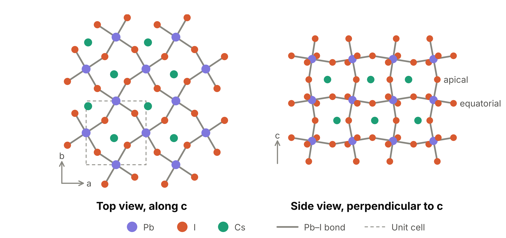
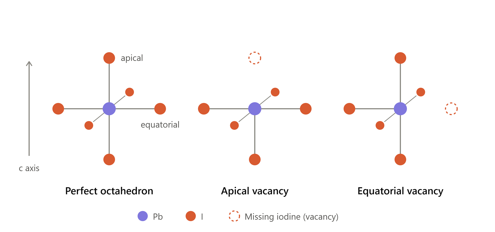
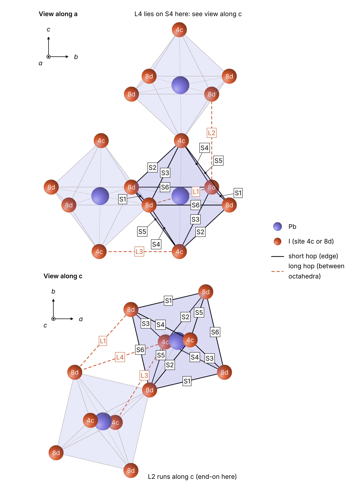

# Formation and Migration of Iodine Vacancies in γ-CsPbI₃

First-principles study of iodine vacancies in orthorhombic γ-CsPbI₃, using Quantum ESPRESSO: bulk defect thermodynamics, hop-resolved diffusion, and the CsI-terminated (001) surface.

## Abstract (work so far, October 2026)

Iodine vacancies are the main mobile defect in γ-CsPbI₃, a promising inorganic perovskite for solar cells, and their migration causes current–voltage hysteresis and degradation. Tilted octahedra in the γ phase create two inequivalent iodine sites, apical (4c) and equatorial (8d), yet published studies report only three migration path types and do not state the vacancy charge state. Using density functional theory (PBEsol) in 159-atom supercells, we compared both sites for the neutral and +1 vacancy and identified the symmetry-distinct hops. The +1 vacancy showed almost no site preference (8d lower by 1 meV), whereas the neutral vacancy favoured the apical site by about 40 meV, opposite to the published result. The neutral vacancy behaved as a shallow donor, with its extra electron delocalized over the crystal. Symmetry analysis revealed ten distinct hops, six short and four long, rather than three. A literature comparison suggests the published benchmark used an unusually weakly tilted lattice. These results show that iodine vacancy energetics in γ-CsPbI₃ depend on both charge state and octahedral tilt, and they set the reference for the barrier calculations that follow.

The neutral value is provisional: the neutral apical relaxation has converged forces but its energy is still settling (about 0.3 meV per step). The abstract covers the bulk work done so far; the scope was extended on 23 October 2026 (see Scope).

This repository holds the inputs, scripts and text outputs. Scratch data (wavefunctions, charge densities) is not tracked.

## Status

| Stage | State |
|---|---|
| Convergence test, soft and tight relaxation of the unit cell | Done |
| Cluster setup; `neb.x` and `pp.x` compiled (Quantum ESPRESSO 6.5) | Done |
| Perfect 2×2×2 supercell relaxation | Done |
| Vacancy relaxations (4 jobs) | +1 pair and neutral equatorial done; neutral apical finishing (forces converged) |
| Set of distinct bulk hops | Settled: 10 (6 short, 4 long) |
| Hop end points and NEB inputs (`build_neb.py`, `hop_network.py`, `run_neb.pbs`) | Done |
| Bulk barriers (NEB) | To do: staged; stage 1 = S1, S2, L3, S6, the hops comparable with published values (see Methods) |
| Part A: reference phases and chemical-potential region (step 5) | To do |
| Part A: formation energies, transition levels, defect concentrations (step 6) | To do |
| Part B: diffusion coefficients and anisotropy (step 7) | To do |
| Part C: CsI-terminated slab, vacancies and barriers against depth (steps 8–10) | To do |

## Introduction

### γ-CsPbI₃

CsPbI₃ is a halide perovskite with the formula ABX₃. Each Pb atom sits at the centre of an octahedron of six iodine atoms. The octahedra share corners and form a three-dimensional network, and the Cs atoms fill the cavities between them.

The compound exists in several phases:

| Phase | Structure | Notes |
|---|---|---|
| α | Cubic perovskite, octahedra not tilted | Stable only at high temperature |
| β | Tetragonal perovskite, tilted about one axis | Intermediate, on cooling from α |
| γ | Orthorhombic perovskite, tilted about all three axes | The black perovskite phase found at room temperature; metastable |
| δ | Orthorhombic, not a perovskite (yellow) | The stable phase at room temperature; poor light absorber |

The γ phase is the one used in solar cells and light emitters, with a band gap of about 1.7 eV.

At zero temperature the cubic structure is not a minimum of the energy: the octahedra lower their energy by tilting. A relaxation without thermal motion, such as the calculations here, therefore belongs to the γ structure. It is also the perovskite phase present in devices at room temperature.



The figure is drawn from the soft-relaxed structure in `01_unitcell/final/`; the tight relaxation changes it by less than 0.03 Å, which is not visible at this scale. The top view shows one layer of octahedra (Pb with its four in-plane iodine atoms) and the Cs atoms above it; the octahedra are rotated about c, in opposite senses for neighbours. The side view shows one sheet of octahedra seen along the in-plane diagonal; the Pb–I–Pb links along c are bent instead of straight.

| Property | Value (this work, PBEsol) |
|---|---|
| Space group | Pnma (No. 62), written here in the Pbnm setting with c as the long axis |
| Atoms per unit cell | 20 (4 Cs, 4 Pb, 12 I) |
| Lattice parameters | a = 8.362 Å, b = 8.961 Å, c = 12.350 Å |
| Pb–I bond lengths | 3.17 to 3.19 Å |
| Pb–I–Pb angles | 148° (equatorial) and 155° (apical); 180° in the cubic phase |
| Iodine sites | 4 apical (linking octahedra along c) and 8 equatorial (linking them within the ab plane) |

The tilting is what makes the two iodine sites different, and it is the reason the defect study below treats apical and equatorial positions separately.

### Defect - The two iodine sites



Each Pb sits at the centre of an octahedron of six iodines. Because the octahedra are tilted, the six are not all equivalent:

- **Apical (4c)**: the two above and below Pb, along c, in the CsI layers.
- **Equatorial (8d)**: the four around Pb, in the PbI₂ layers.

### Why defects matter

Halide perovskites tolerate defects electronically: most native defects leave no deep trap states, which is why solution-processed films still perform well. Their weak point is ionic. Iodine vacancies form easily and move at room temperature, and moving ions cause:

- current–voltage hysteresis and slow, drifting response in solar cells and detectors;
- ions piling up at interfaces and reacting with contacts;
- loss of stability, including the change of γ-CsPbI₃ to the yellow δ phase, which tends to start at surfaces and grain boundaries.

Surfaces are where vacancies form, collect and escape, and where the perovskite meets the other device layers. How fast vacancies move near the surface, and whether they are drawn to it, guides surface passivation and interface design.

## Literature review

Full notes, numbers and sources: [`Literatures/literature_review.md`](Literatures/literature_review.md).

| Paper | What it did | What it leaves open |
|---|---|---|
| **Arber 2025** (anchor) | Bulk γ-CsPbI₃, PBEsol, 2×2×2 supercell: iodine vacancy barriers 0.34 eV (8d-8d), 0.35 eV (8d-4c), about 0.77 eV (4c-4c); MD activation energy 0.42 eV | Surfaces; more than one barrier per type of path; the charge state |
| Biega 2021 | Cubic CsPbBr₃ slabs: the long axial-to-axial barrier is about half the bulk value at the surface | Edge hops; the tilted phase; a slab whose barriers return to the bulk value |
| Ahmad 2024 | Orthorhombic CsPbI₃ 17-layer slabs: vacancy and interstitial formation energies against depth | Barriers; a slab interior that matches its own bulk (off by 0.05 to 0.66 eV) |
| Zhang 2025 | Bulk γ-CsPbI₃ under strain, PBEsol: two V_I paths, about 0.51 eV (edge towards the apical site) and 0.54 eV (in-plane); rectangular relaxed cell with PBEsol, PBE and HSE06; V_I a shallow donor | Charge state and supercell size; site energies; only two paths |

**Methods we adopt from the group's earlier work** (J.-B. Liu, Tsinghua; same approach for other halide perovskites):

| Paper | What it did | What we take |
|---|---|---|
| Xu 2017 (J. Phys. Chem. Lett. 8, 4391) | Cs₂AgInBr₆: chemical-potential stability region, formation energies of all intrinsic defects against E_F, transition levels, self-consistent Fermi level and defect and carrier concentrations | Part A, steps 5–6 |
| Xu 2019 (J. Power Sources 412, 689) | Cs₂AgInX₆: CI-NEB for the dominant defects only (vacancy and concerted interstitial mechanisms), diffusion coefficients, strain effect. SI: barriers change by ≤ 0.02 eV between PBE+SOC, HSE+SOC and HSE; halogen-vacancy levels stay at the band edge in all three | Part B, step 7; barriers kept at the GGA level |
| Zhou 2021 (J. Mater. Chem. A 9, 6955) | CsGe₁₋ₓSnₓI₃: deep or shallow defect levels from aligned Kohn–Sham levels (Cs 1s core level), partial charge densities, COHP | Defect-state analysis of the neutral vacancy |

Their workflow: relax with PBE+SOC, single points with HSE06+SOC, core-level potential alignment, no image-charge term. Their compounds contain no lead, so their small SOC effects do not transfer automatically to CsPbI₃ (SOC moves the Pb-6p conduction band by about 1 eV); we check SOC on our own cells.

### The gap

One point per paper:

- **Arber 2025** gives one barrier per type of path, although the tilted structure has several distinct variants of each, and does not state the charge state.
- **Biega 2021** shows a surface effect for one long jump only, in the cubic bromide, in a thin, partly frozen slab that never returns to the bulk.
- **Ahmad 2024** has the right material and surface, but only formation energies, and its slab interior does not reproduce its bulk.

**Overall gap:** nobody has computed iodine vacancy migration barriers in γ-CsPbI₃ layer by layer below the surface, in a slab whose interior reproduces the bulk.

This appears as three specific gaps:

| Gap | Statement |
|---|---|
| **G0 — Defect picture** | No consistent picture of which intrinsic defects dominate γ-CsPbI₃, in which charge state, computed with the same settings as the barriers. Paper C covers equatorial sites only, with PBE+D3 on the experimental cell; most other defect studies use the cubic phase. |
| **G1 — Hop resolution** | Bulk barriers are known only per type of path. The tilted structure has 10 symmetry-distinct hops (6 short, 4 long), and which charge state the published values belong to is not stated. |
| **G2 — Depth** | The surface effect on vacancy migration is known for one long jump in cubic CsPbBr₃ only. For γ-CsPbI₃ there are no barriers against depth, and how deep the surface reaches is unknown. |
| **G3 — Slab–bulk consistency** | Neither surface study recovers its own bulk inside the slab, so surface and bulk values cannot be compared cleanly. |

### Research questions

| | Question | Gap | Hypothesis |
|---|---|---|---|
| **RQ0** | Which intrinsic defects dominate γ-CsPbI₃, in which charge state, under which growth conditions? | G0 | **H0.** V_I is a shallow donor, in the +1 state for any Fermi level in the gap, and one of the dominant defects; V_Pb or V_Cs is the main acceptor. |
| **RQ1** | Which site does the vacancy prefer, and by how much, in each charge state? | G1 | **H1.** 8d by a few hundredths of an eV in both; one charge state reproduces paper A's +0.03 eV. |
| **RQ2** | What are the bulk hop barriers, and how do the number and direction of hops shape transport in the ab plane and along c? What diffusion coefficients and ionic conductivity follow? | G1 | **H2.** Variants of one type differ by a few hundredths of an eV; long hops are clearly higher. Transport along c needs 4c–8d hops, so it is set by their barriers and by how often the vacancy sits on 4c: diffusion is anisotropic. |
| **RQ3** | How do site energies and barriers change layer by layer below the CsI-terminated surface? | G2 | **H3.** Barriers drop and the vacancy is slightly more stable in the top layers; the effect fades within two to three layers (about 1 nm). |
| **RQ4** | Once the surface splits each pair of equivalent hops, which direction is favoured? | G2 | **H4.** Hops towards the surface are easier, giving a net drift of vacancies to the surface. |
| **RQ5** | Does the middle of the slab reproduce the bulk site energy and barrier? | G3 | **H5.** Yes, within about 0.02 eV, for a symmetric 11-layer slab with all atoms free. |

**Novelty**

| | Contribution | Gap |
|---|---|---|
| **N1** | The hop network of the vacancy (barriers, multiplicities, directions) with both charge states stated, and a bulk reference for every hop the slab will split | G1 |
| **N2** | First depth-resolved vacancy barriers in γ-CsPbI₃, followed back to the bulk | G2 |
| **N3** | The surface splitting of equivalent hops as a measure of directional drift | G2 |
| **N4** | A slab checked against its own bulk reference | G3 |
| **N5** | One consistent set of settings from defect thermodynamics to diffusion: charge state, site preference, hop network and diffusion coefficients together | G0, G1 |

Limits on the novelty claim: a web search and a cited-by check of papers A, B and C (October 2026, Google Scholar and the publishers' "cited by" lists) found no depth-resolved vacancy barriers in γ-CsPbI₃. The closest work: Pols 2022 (reactive MD of CsPbI₃ slabs; iodine vacancies seen moving in and out of the surface, no barriers), surface studies of CsPbI₃ with formation energies only (Li et al., arXiv 2411.01599; arXiv 2309.04870), and bulk-only migration studies (Tyagi et al., arXiv 2409.16051; Miskin 2025). Paper C's group (Ahmad) works on defect mobility near interfaces in other materials and is the most likely to extend C to barriers.

**If the hypotheses fail.** If H3 is false (no change below the top layer), the surface effect is confined to one layer; that still answers G2. If H5 is false, comparing the neutral and +1 vacancy separates a structural mismatch from a charge-referencing one; that answers G3.

### Scope

Extended on 23 October 2026 after feedback from the supervisor: the bulk work now covers which defects form and in which charge state (Part A) and how fast the vacancy diffuses (Part B), in the style of the group's earlier work. The surface (Part C) remains the novelty.

| Part | Content | Steps | Needed for |
|---|---|---|---|
| **A. Bulk defect thermodynamics** | Chemical-potential region of γ-CsPbI₃ against CsI, PbI₂ (and Cs₄PbI₆, CsPb₂I₅), Cs, Pb, I₂; formation energies against E_F for V_I (+1, 0) and the main competing defects V_Pb²⁻, V_Cs⁻, I_i (−, 0, +); transition levels with core-level alignment; self-consistent Fermi level and defect concentrations at 300 K | 5, 6 | G0 |
| **B. Bulk migration** | 4c and 8d site energies (done); NEB in stages, starting with the hops that have published values; iodine interstitial NEB if Part A shows it dominant; diffusion coefficients, anisotropy and ionic conductivity | 3, 4, 7 | G1 |
| **C. Surface** | CsI-terminated (001) slab whose middle reproduces the bulk; V_I formation energy and barriers layer by layer, using the chemical potentials of Part A | 8–10 | G2, G3 |

**Settings.** PBEsol without spin–orbit coupling or dispersion for all relaxations and NEBs (consistent with everything done, and with paper A). Spin–orbit coupling and, if time allows, HSE06 enter as single points on the relaxed defect cells, where they matter (transition levels). The supervisor's group found barriers within 0.02 eV across functionals.

**Not in the current scope**

- The full set of about 20 intrinsic defects (to be confirmed with the supervisor; the four defects above set the Fermi level)
- δ-CsPbI₃ in the stability region: γ is metastable against δ, so the region is drawn without δ, as is usual
- PbI₂ termination and other facets
- Machine-learned potentials and long-time dynamics

**Optional, later:** strain effect on the lowest barrier (as in the group's 2019 paper and Zhang 2025); cubic α-CsPbI₃ as a no-tilt reference barrier; partial charge density of the neutral vacancy state.

## Methods

### Settings

| Item | Value |
|---|---|
| Code | Quantum ESPRESSO `pw.x`: version 7.6 on the laptop (convergence test, soft relaxation), version 6.5 on the cluster (tight relaxation and all defect calculations) |
| Functional | PBEsol |
| Spin-orbit coupling | Not included in relaxations and NEB (scalar-relativistic pseudopotentials); single-point check on the defect cells in step 6 |
| Dispersion correction | None |
| Pseudopotentials | SSSP 1.3.0 PBEsol efficiency |
| Plane-wave cutoff | 60 Ry (density 480 Ry) |
| k-mesh, 20-atom cell | 4×4×3 |
| k-mesh, 160-atom supercell | 2×2×2 |

Pseudopotential files:

| Element | File |
|---|---|
| Cs | `cs_pbesol_v1.uspp.F.UPF` |
| Pb | `Pb.pbesol-dn-kjpaw_psl.0.2.2.UPF` |
| I | `I.pbesol-n-kjpaw_psl.0.2.UPF` |


| Step | Calculation | Result |
|---|---|---|
| 1 | Tight relaxation of the 20-atom cell | Reference lattice. **Done** |
| 2 | Perfect 2×2×2 supercell (160 atoms) | Energy reference |
| 3 | 4c and 8d vacancy, charge +1 and neutral | Site energy difference; charge state compared with paper A |
| 4 | NEB for the 10 distinct bulk hops | Bulk barriers; validation against paper A |
| 5 | Reference phases: Cs, Pb, I₂, CsI, PbI₂ (Cs₄PbI₆, CsPb₂I₅) | Chemical-potential region of γ-CsPbI₃ |
| 6 | Defect cells V_Pb, V_Cs, I_i (with V_I from step 3); core-level alignment; SOC single points | Formation energies against E_F, transition levels, self-consistent Fermi level and concentrations |
| 7 | Barriers + hop network + site energies (+ step 6 concentrations) | Diffusion coefficients, anisotropy, ionic conductivity |
| 8 | CsI-terminated (001) slab: build and convergence | Slab whose middle reproduces the bulk |
| 9 | Vacancies at increasing depth | Site and formation energy against depth |
| 10 | NEB at increasing depth | Barriers against depth, converging to step 4 |

One vacancy per supercell; the cell is fixed in all defect calculations.

### Bulk (steps 2 to 4)

**Validation targets from paper A** (same material, functional and supercell):

| Quantity | Paper A | Our check |
|---|---|---|
| Vacancy site energy, 4c minus 8d | about +0.03 eV (inferred from the end points of its Fig. S1, not stated in the text) | Step 3, both charge states |
| Barrier 8d to 8d | 0.34 eV | Step 4 |
| Barrier 8d to 4c (average of both directions) | 0.35 eV | Step 4 |
| Barrier 4c to 4c (long jump) | about 0.77 eV | Step 4 |

Paper A does not state its charge state; whichever of ours reproduces these numbers indicates which one they used. A second reference, Zhang 2025 (PBEsol, rectangular cell like ours), gives about 0.51 eV for an edge hop towards the apical site and 0.54 eV for an in-plane hop, read from its Fig. 6c; its edge-hop profile ends about 15 meV below its start.

**Hop set.** All octahedra are equivalent (Pb on Wyckoff site 4b), and Pb is an inversion centre, so the 12 edges of one octahedron give **6 short hops** (S1–S6). Hops between corner-sharing octahedra give **4 long hops** (L1–L4).



| Hop | Ends | Length (Å) | | Hop | Ends | Length (Å) |
|---|---|---|---|---|---|---|
| S1 | 8d–8d | 4.41 | | L1 | 8d–8d | 4.80 |
| S2 | 4c–8d | 4.43 | | L2 | 8d–8d | 5.18 |
| S3 | 4c–8d | 4.45 | | L3 | 4c–4c | 5.28 |
| S4 | 4c–8d | 4.53 | | L4 | 4c–8d | 5.93 |
| S5 | 4c–8d | 4.56 | | | | |
| S6 | 8d–8d | 4.60 | | | | |

Lengths from the tight-relaxed cell. One vacancy per site type is enough in the bulk. Each 4c–8d NEB gives both directions.

**Hop network** (`04_bulk_neb/hop_network.py`, from the perfect supercell). How many hops of each kind one vacancy has, and where they go:

| Hop | Ends | From an 8d vacancy | From a 4c vacancy | Moves the vacancy |
|---|---|---|---|---|
| S1, S6 | 8d–8d | 2 each | 0 | within a PbI₂ layer |
| S2, S3, S4, S5 | 4c–8d | 1 each | 2 each | between a PbI₂ and a CsI layer |
| L1 | 8d–8d | 1 | 0 | within a PbI₂ layer |
| L2 | 8d–8d | 1 | 0 | straight along c, across a CsI layer |
| L3 | 4c–4c | 0 | 2 | within a CsI layer |
| L4 | 4c–8d | 1 | 2 | between layers |
| Total | | 11 | 12 | |

Half of the short hops from an 8d site lead to a 4c site, and a 4c vacancy has no short hop to another 4c site. Transport in the ab plane can run on 8d–8d hops alone; along c it needs 4c–8d hops (8d → 4c → 8d) or the long L2. So the barriers of all three kinds, their numbers, and the 4c/8d site energies together decide the diffusion and its anisotropy, not the lowest barrier alone.

**Which hops match published paths.** The papers name path types, not variants, so we matched them by geometry:

| Published path | Value | Our hop | How identified |
|---|---|---|---|
| Arber: 4c–4c in the Cs–I plane | about 0.77 eV | **L3** | The only 4c–4c hop |
| Arber: 8d–8d edge in the Pb–I plane | 0.34 eV | S1 or S6 | Not identifiable: Arber's Fig. 1 is a schematic |
| Arber: 8d–4c edge | 0.35 eV (average of both directions) | one of S2–S5 | Not identifiable, as above |
| Zhang: "in-plane" path | about 0.54 eV | **S1** (probable) | Arrow in its Fig. 6b rises about 1 Å along c: S1 (1.00 Å), not S6 (0 Å) |
| Zhang: "out-of-plane" path | about 0.51 eV | **S2** (probable) | Arrow in its Fig. 6a rises about 2.7 Å along c with almost no sideways component in the [110] view: S2 (2.59 Å, 0.4 Å sideways), not S3/S5 (3.59 Å) or S4 (1.2 Å sideways) |

The Zhang assignments are read from a raster figure (about ±0.3 Å) and assume a view along [110] with the same a < b labelling as ours (their PBEsol cell, 8.39 / 8.96 / 12.37 Å, has it).

**NEB plan (staged).**

| Stage | Hops | Purpose |
|---|---|---|
| 1: comparison with published values | **S1, S2, L3, S6** | S1 and S2 are like-for-like with Zhang and stand for Arber's 8d–8d and 8d–4c types; L3 is Arber's 4c–4c jump; S6 is the other 8d–8d edge (Arber's could be either) and gives a first measure of the spread within a type |
| 2: spread of the 4c–8d hops | S3, S4, S5 | Completes the edge hops between layers, which control transport along c |
| 3: long hops, only if needed | L1, L2, L4 | No published values; needed if the network or anisotropy analysis calls for them (L2 is the direct route along c) |

If S1 and S6 (and S2–S5) differ by less than about 0.03 eV, one barrier per type is reported with the spread as its uncertainty. At 300 K a 0.05 eV difference changes a rate about sevenfold, so the threshold is kept small. Charge +1 first; neutral for stage 1. Each hop that the surface splits is later compared with its own bulk value, not a type average.

**Checks**

- Neutral vacancy: total magnetisation expected about 1 μB per cell if the extra electron localizes. Found: 0 μB in both relaxations (shallow donor, electron delocalized).

### Defect thermodynamics (steps 5 and 6)

Formation energy of defect X in charge state q:

E_f[X^q] = E[X^q] − E[perfect] + Σ nᵢ μᵢ + q (E_VBM + E_F) + qΔV

- μᵢ: chemical potentials, limited by the stability of γ-CsPbI₃: Δμ_Cs + Δμ_Pb + 3Δμ_I = ΔH_f(CsPbI₃); every Δμᵢ ≤ 0; no competing phase forms (e.g. Δμ_Cs + Δμ_I < ΔH_f(CsI), Δμ_Pb + 2Δμ_I < ΔH_f(PbI₂)). With three elements the region is a polygon in the (Δμ_Pb, Δμ_I) plane.
- E_F: a free variable from the VBM to the CBM; transition levels ε(q/q′) are the kinks.
- qΔV: potential alignment from core levels far from the defect (the group's method). The image-charge term is estimated separately; for V_I⁺ it is about 0.06 eV (static dielectric constant about 18).
- Concentrations: c = N_sites g exp(−E_f/k_BT), with the Fermi level solved self-consistently from charge neutrality including electrons and holes (Ma & Wei 2011).
- Not needed for site differences or barriers: both ends have the same charge in the same cell.

### Diffusion (step 7)

D = f a² ν exp(−E_a/k_BT) per hop, ν = 10¹² Hz, combined over the hop network (counts, directions, 4c/8d occupation) analytically or by kinetic Monte Carlo, giving D along a, b and c. With the vacancy concentration from step 6, the ionic conductivity follows from the Nernst–Einstein relation and can be compared with measured activation energies.

## Results so far

### Convergence

| k-mesh (50 Ry) | Energy above 6×6×4 (meV/atom) |
|---|---|
| 2×2×1 | 45.46 |
| 3×3×2 | 2.52 |
| 4×4×3 | 0.23 |
| 5×5×4 | 0.004 |

| Cutoff (4×4×3) | Energy above 80 Ry (meV/atom) | Pressure (kbar) |
|---|---|---|
| 40 Ry | 5.83 | −1.89 |
| 50 Ry | 3.29 | −1.57 |
| 60 Ry | 0.86 | −1.48 |
| 70 Ry | 0.40 | −1.35 |
| 80 Ry | 0 | −1.39 |

### Relaxed unit cell

| | a (Å) | b (Å) | c (Å) | Volume (ų) |
|---|---|---|---|---|
| Experiment, 293 K | 8.5766 | 8.8561 | 12.4722 | 947.33 |
| Soft relaxation | 8.3776 | 8.9330 | 12.3518 | 924.38 |
| **Tight relaxation** | **8.3620** | **8.9607** | **12.3503** | **925.41** |
| Tight vs soft | −0.19% | +0.31% | −0.01% | +0.11% |
| Tight vs experiment | −2.50% | +1.18% | −0.98% | −2.31% |

| | Pb–I–Pb angles | Pb–I bond lengths (Å) |
|---|---|---|
| Experiment, 293 K | 150.84° to 160.63° | 3.148 to 3.221 |
| Soft relaxation | 148.09° to 153.54° | 3.172 to 3.188 |
| **Tight relaxation** | **148.19° and 154.54°** | **3.165 to 3.190** |

| | Soft relaxation | Tight relaxation |
|---|---|---|
| Force limit (largest component) | 0.026 eV/Å (10⁻³ Ry/Bohr) | 0.010 eV/Å (4×10⁻⁴ Ry/Bohr) |
| Pressure limit | 0.5 kbar | 0.2 kbar |
| Final largest force component | | 0.0047 eV/Å (1.8×10⁻⁴ Ry/Bohr) |
| Final pressure | −0.04 kbar | −0.13 kbar |
| Steps and time | 37 + 3 evaluations, 16 h 24 min on a 6-core laptop | 14 steps, 1 h 32 min on one 40-core node |
| Code | Quantum ESPRESSO 7.6 | Quantum ESPRESSO 6.5 |

The tight relaxation lowered the energy by 1.9 meV per 20-atom cell. The volume and c hardly changed, but a shortened and b lengthened by 0.2 to 0.3%: the cell is very soft against exchanging a for b, which goes with a small change in octahedral tilt. Run on the soft-relaxed structure, the two code versions gave the same total force to six decimal places.

The defect calculations use the tight-relaxed cell.


### Perfect supercell (2×2×2, 160 atoms)

| | Value |
|---|---|
| Total energy | −65326.88713687 Ry (−888,817.58 eV) |
| Highest occupied level (VBM) | 3.4105 eV |
| Relaxation | Converged on the first SCF, 0 BFGS steps: every force component already below 0.010 eV/Å (4×10⁻⁴ Ry/Bohr) |
| Total force (all atoms) | 0.058 eV/Å (0.0022 Ry/Bohr) |
| Run | Job 217406, 2 nodes (80 cores), 17 SCF iterations, 3 h 6 min |

The supercell built from the tightly relaxed unit cell needed no relaxation, so the 4×4×3 unit-cell mesh and the supercell mesh agree on the forces. Its energy and VBM are the references for the vacancy cells.

### Iodine vacancy, charge +1

| Site | Total energy (Ry) | Run | Convergence |
|---|---|---|---|
| Apical (4c) | −64954.16973158 | Job 217407, 2 nodes | 47 SCF cycles, 46 BFGS steps, largest force 3.1×10⁻⁴ Ry/Bohr, highest occupied level 3.3779 eV |
| Equatorial (8d) | −64954.16980915 | Job 217408, 2 nodes | 59 SCF cycles, 58 BFGS steps, largest force 3.7×10⁻⁴ Ry/Bohr |

E(8d) − E(4c) = −1.06 meV: the two sites are nearly degenerate, equatorial very slightly lower. Same sign as Arber 2025's reported +0.03 eV (4c above 8d), but about 30 times smaller; Arber's charge state is not stated, so the comparison is not yet conclusive (see NOTES.md, open check 7).

### Iodine vacancy, neutral (provisional)

| Site | Total energy (Ry) | Run | Convergence |
|---|---|---|---|
| Apical (4c) | −64953.80112233 (step 68, still settling) | Job 217409, 3 nodes | Running; largest force near 4×10⁻⁴ Ry/Bohr, energy changing about 0.3 meV per step |
| Equatorial (8d) | −64953.79815909 | Job 217410, 3 nodes | 54 SCF cycles, 53 BFGS steps, largest force 3.6×10⁻⁴ Ry/Bohr |

E(8d) − E(4c) ≈ +40 meV (40.3 meV at step 68): the neutral vacancy prefers the apical site, opposite in sign to Arber 2025. The remaining drift is about 0.3 meV per step. Total magnetisation is 0 μB in both cells: the extra electron is delocalized (shallow donor). Zhang 2025 also finds V_I a shallow donor (PBEsol, with spin–orbit coupling for the levels). Two further checks agree: the Fermi level of the neutral cells lies 1.56 eV (4c) and 1.68 eV (8d) above the pristine VBM, and the rough transition level E(0) − E(+1) − E_VBM is 1.61 eV (4c) and 1.65 eV (8d), both at the band edge (gap about 1.6 eV without SOC). These are uncorrected; step 6 gives the proper transition level. PBEsol tends to over-delocalize, so an HSE check would settle it.

### Comparison with the published benchmark

Arber 2025's relaxed cell is nearly square in the ab plane (8.68 and 8.71 Å, 0.3% apart), unlike experiment (8.58 and 8.86 Å, 3.3%) and every other 0 K relaxation found: ours (7.2%), Seidu 2021 PBEsol (7.6%), Zhang 2025 PBEsol (6.8%) and HSE06 (7.5%), and LDA, PBE and SCAN (4–13%). The hybrid-functional cell shows that the rectangular shape is not an artefact of semilocal DFT. Zhang 2025's edge hop towards the apical site ends about 15 meV below its start (read from its Fig. 6c), the same direction as our neutral result, but its charge state is not stated. The 4c and 8d sites differ only through octahedral tilt, so a less-tilted cell may explain part of the difference in site energies. Details: `Literatures/literature_review.md`.

## File structure

One folder per step of the Methods. The steps that have not started yet hold only a `.gitkeep`.

```
.
├── README.md                    this file
├── NOTES.md                     working notes: cluster, jobs, decisions, commands
├── Literatures/                 literature_review.md (papers A, B and C in detail, plus related work) and the papers (not tracked)
├── LICENSE
├── run_qe.pbs                   PBS job script for pw.x, shared by all cluster jobs
├── assets/                      figures used in this README
│
├── 01_unitcell/                 step 1: convergence test, soft and tight relaxation of the 20-atom cell
├── 02_pristine/                 step 2: perfect 2×2×2 supercell (160 atoms)
├── 03_vacancies/                step 3: 4c and 8d vacancies, charge +1 and neutral
├── 04_bulk_neb/                 step 4: build_neb.py (NEB inputs), hop_network.py and hop_network.txt (hop counts and directions)
├── run_neb.pbs                  PBS job script for neb.x (fat96 nodes, swap guard)
├── presentation/                progress report for the supervisor (Beamer source and PDF)
├── 05_reference_phases/         step 5: Cs, Pb, I₂, CsI, PbI₂ (to do)
├── 06_defect_formation/         step 6: V_Pb, V_Cs, I_i cells, alignment, formation energies, concentrations (to do)
├── 07_diffusion/                step 7: diffusion coefficients and anisotropy (to do)
├── 08_slab/                     step 8: CsI-terminated (001) slab, build and convergence (to do)
├── 09_slab_vacancies/           step 9: vacancies at increasing depth (to do)
└── 10_slab_neb/                 step 10: NEB at increasing depth (to do)
```

### `01_unitcell/`

```
01_unitcell/
├── gamma_CsPbI3_vcrelax.in      base input: experimental γ-CsPbI₃ cell (20 atoms) and settings
├── kconv.sh                     convergence test (k-mesh and cutoff)
├── conv/                        its inputs and outputs: k221 … k664 at 50 Ry, e40 … e80 at 4×4×3
├── conv_summary.txt             energies from the convergence test
├── relax2stage.sh               two-stage variable-cell relaxation (soft)
├── stage1_k332/                 stage 1, coarse 3×3×2 k-mesh: vcrelax.in, vcrelax.out
├── stage2_k443/                 stage 2, converged 4×4×3 k-mesh: vcrelax.in, vcrelax.out
├── final/                       soft-relaxed structure: scf-ready input, structure blocks, .cif
├── relax_summary.txt            energies, forces, timing; lattice against experiment
└── tight/                       tight relaxation, run on the cluster
    ├── unit_tight_relaxed.in    the tight-relaxed cell; every later structure is built from it
    ├── vcrelax.in               tight-relaxation input
    ├── vcrelax.out              its output
    └── vcrelax.cif
```

The base input holds the experimental room-temperature structure (Sutton et al., ACS Energy Lett. 2018). Both shell scripts read it from their own folder and neither changes it.

### `02_pristine/` and `03_vacancies/`

```
02_pristine/
├── relax.in                     perfect supercell, atoms relaxed at fixed cell: the energy reference
└── relax.cif

03_vacancies/
├── build_defects.py             writes 01_unitcell/tight/vcrelax.in, 02_pristine/ and 03_vacancies/
├── sites_report.txt             which atoms were removed
├── q+1/                         charge +1
│   ├── vac_I_apical/            vacancy on a 4c site: relax.in, relax.cif
│   └── vac_I_equatorial/        vacancy on an 8d site
└── q0/                          the same two, neutral and spin-polarised
    ├── vac_I_apical/
    └── vac_I_equatorial/
```

`build_defects.py` builds vacancies only. The NEB inputs come from `04_bulk_neb/build_neb.py` (end points by symmetry from the relaxed vacancies, IDPP path, `neb.in`), for example `python3 04_bulk_neb/build_neb.py S1 --charge q+1`. `04_bulk_neb/hop_network.py` writes the hop counts and directions to `hop_network.txt`.

`run_qe.pbs` loads the modules and runs `pw.x` in the folder it is submitted from, with as many processes as nodes × 40. Give the node count, input name and k-point pools on the `qsub` line, for example `qsub -N pristine -l nodes=2:ppn=40 -v INPUT=relax.in,NK=2 <path>/run_qe.pbs`. Check memory first: see `NOTES.md`.

The cluster copy lives in `~/cspbi3/` with its own layout (`pristine_222/`, `q+1/`, `q0/`).

## How to reproduce

Python used for the scripts (WSL, system Python): Python 3.14.4, numpy 2.3.5, scipy 1.16.3, ASE 3.26.0, spglib 2.7.0. The cluster has no Python; scripts run locally and their outputs are copied to the cluster.

```bash
# 1. convergence test and soft relaxation
cd 01_unitcell
bash kconv.sh | tee conv_summary.txt
bash relax2stage.sh
cd ..

# 2-3. supercell and vacancy inputs (from the project root, after the tight relaxation)
python3 03_vacancies/build_defects.py 01_unitcell/tight/unit_tight_relaxed.in --pseudo-dir /path/to/pseudo
```

Set `PW` (path to `pw.x`) and `NP` (number of MPI processes) at the top of each shell script. Set `pseudo_dir` in `01_unitcell/gamma_CsPbI3_vcrelax.in`. `build_defects.py` needs Python 3 with NumPy and ASE.

## Not tracked

Listed in `.gitignore`:

- `tmp/` and `*.save/`: Quantum ESPRESSO scratch data
- `*.wfc*`, `*.xml`: wavefunctions and data files
- `backup/`, `*:Zone.Identifier`, `__pycache__/`
- `Literatures/*.pdf`, `Literatures/*.docx`: the papers and supporting information (copyrighted), kept locally only

## Next steps

1. Finish the neutral apical relaxation; final neutral site energy.
2. In parallel: NEB stage 1 at +1 (S1, S2, L3, S6) on fat96, and the step-5 reference phases (small jobs).
3. Step 6: V_Pb, V_Cs and I_i cells (memory check first), core-level alignment, SOC single points; formation-energy diagram and concentrations.
4. NEB stage 2 (S3–S5); interstitial NEB if step 6 shows it dominant; step 7 diffusion coefficients.
5. Part C: build the CsI-terminated slab and run the convergence tests before any defect in it.
6. To confirm with the supervisor: the defect set for step 6 (four defects or all intrinsic ones), and whether SOC should enter the relaxations.
